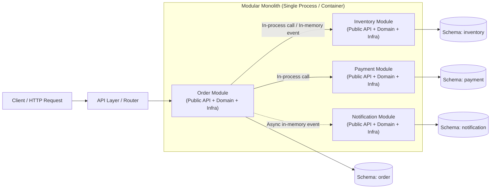
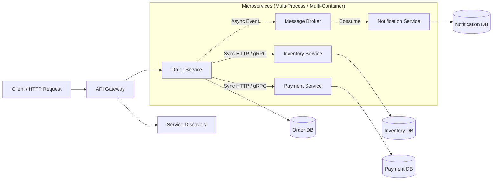
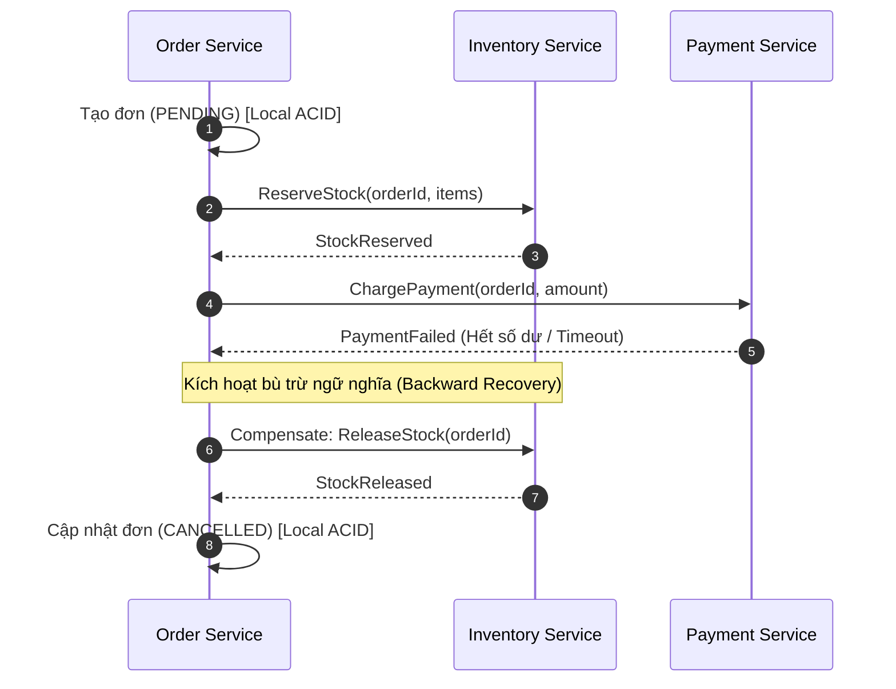

# CHƯƠNG 2. CƠ SỞ LÝ THUYẾT

Chương này trình bày hệ thống nguyên lý nền tảng của kỹ thuật phần mềm và hệ thống phân tán nhằm lý giải bản chất vận hành của hai mô hình kiến trúc: **Kiến trúc Nguyên khối Mô-đun hóa (Modular Monolith)** và **Kiến trúc Vi dịch vụ (Microservices Architecture - MSA)**. Thay vì dừng ở mức định nghĩa khái niệm, mỗi mục lý thuyết đều phân tích trực tiếp cơ chế tác động của nguyên lý đó lên cấu trúc giao tiếp, tính toàn vẹn dữ liệu, hiệu năng xử lý và độ phức tạp vận hành giữa hai kiến trúc.

---

## 2.1. Tổng quan về Kiến trúc Phần mềm

Kiến trúc phần mềm (*Software Architecture*) quy định cấu trúc tổng thể của hệ thống thông qua tập hợp các thành phần phần mềm, các mối quan hệ giữa chúng và các thuộc tính ngoại hiện của cả hai. Trong quá trình thiết kế, kiến trúc sư thường lựa chọn giữa các phong cách kiến trúc (*Architectural Styles*) mang tính vĩ mô (như nguyên khối hay phân tán) và các mẫu kiến trúc (*Architectural Patterns*) giải quyết bài toán cụ thể ở tầng thành phần hoặc dữ liệu.

Giá trị của một lựa chọn kiến trúc không nằm ở mức độ phổ biến của công nghệ mà được đánh giá qua các thuộc tính chất lượng (*Quality Attributes*). Đối với bài toán so sánh giữa Modular Monolith và Microservices, sáu thuộc tính chất lượng chịu tác động trực tiếp nhất bao gồm:

- **Hiệu năng (*Performance*):** Phản ánh thời gian đáp ứng (*latency*) và thông lượng (*throughput*) của hệ thống dưới một mức tải xác định. Thuộc tính này chịu chi phối trực tiếp bởi cơ chế giao tiếp nội bộ trong bộ nhớ so với giao tiếp qua mạng.
- **Khả năng mở rộng (*Scalability*):** Thể hiện năng lực đáp ứng khi tải tăng lên thông qua mở rộng dọc (*vertical scaling* — tăng tài nguyên cho một nút) hoặc mở rộng ngang (*horizontal scaling* — nhân bản số lượng tiến trình/nút).
- **Khả năng sửa đổi (*Modifiability*):** Đo lường mức độ dễ dàng và chi phí khi thay đổi hoặc bổ sung nghiệp vụ mà không gây hiệu ứng dây chuyền sang các thành phần khác.
- **Tính sẵn sàng (*Availability*) và Độ tin cậy (*Reliability*):** Phản ánh tỷ lệ thời gian hệ thống hoạt động bình thường và khả năng duy trì tính đúng đắn khi một thành phần gặp sự cố cục bộ.
- **Khả năng triển khai (*Deployability*):** Liên quan đến tần suất phát hành, độ phức tạp đóng gói, cấu hình hạ tầng và rủi ro khi đưa phiên bản mới vào vận hành.

Sự khác biệt căn bản giữa Modular Monolith và Microservices bắt nguồn từ cách hai mô hình này đánh đổi giữa các thuộc tính nêu trên: một bên tối ưu hóa hiệu năng giao tiếp, tính nhất quán cục bộ và sự đơn giản khi triển khai; bên còn lại ưu tiên tính độc lập triển khai và khả năng mở rộng chọn lọc theo từng dịch vụ, chấp nhận chi phí phát sinh từ môi trường phân tán.

---

## 2.2. Nguyên lý Thiết kế Hệ thống Mô-đun

Nền tảng lý thuyết của việc phân rã hệ thống phần mềm thành các mô-đun được David L. Parnas đặt ra từ năm 1972 và hệ thống hóa lại trong công trình hồi tưởng về *Che giấu thông tin (Information Hiding)*. Theo Parnas, một mô-đun (*module*) cần được hiểu là một đơn vị phân công công việc (*work assignment*) cho cá nhân hoặc nhóm phát triển, độc lập với ngôn ngữ lập trình hay tiến trình hệ điều hành. Tiêu chí quan trọng nhất để phân chia ranh giới mô-đun là mỗi mô-đun phải che giấu được một quyết định thiết kế dễ thay đổi (*"secret"* — chẳng hạn cấu trúc dữ liệu nội bộ, thuật toán xử lý hoặc chi tiết lưu trữ) phía sau một giao diện trừu tượng (*abstract interface*) chỉ bộc lộ những giả định bền vững.

Để bảo đảm khả năng bảo trì lâu dài, thiết kế mô-đun cần tuân thủ đồng thời bốn nguyên lý:

1. **Tách biệt mối quan tâm (*Separation of Concerns - SoC*):** Mỗi thành phần chỉ đảm nhiệm một trách nhiệm nghiệp vụ hoặc kỹ thuật xác định, tránh trộn lẫn logic xử lý của nhiều miền khác nhau.
2. **Độ gắn kết cao và Độ ghép nối lỏng (*High Cohesion & Low Coupling*):** Các thành phần có liên quan mật thiết về dữ liệu và hành vi được đặt chung trong một mô-đun, trong khi sự phụ thuộc giữa các mô-đun khác nhau được giữ ở mức tối thiểu thông qua giao diện công khai.
3. **Kiểm soát quan hệ phụ thuộc (*Uses Relation*):** Parnas lưu ý rằng việc phân chia mô-đun theo luồng điều khiển tuần tự (*flow-chart instinct*) hoặc theo cấu trúc tổ chức hiện tại thường dẫn đến các giao diện cồng kềnh và sự phụ thuộc chéo khó kiểm soát. Thay vào đó, quan hệ `"uses"` giữa các chương trình cần được thiết lập rõ ràng và không tạo chu trình.
4. **Thiết kế Hướng miền (*Domain-Driven Design - DDD*) và Ngữ cảnh giới hạn (*Bounded Context*):** Trong các hệ thống nghiệp vụ hiện đại, nguyên lý che giấu thông tin của Parnas được cụ thể hóa bằng việc phân chia hệ thống theo các miền nghiệp vụ (*Bounded Contexts*). Mỗi ngữ cảnh giới hạn sở hữu mô hình dữ liệu và ngôn ngữ nghiệp vụ riêng, giao tiếp với bên ngoài qua hợp đồng rõ ràng.

**Tác động lên hai kiến trúc:** Công trình của Parnas chỉ ra một điểm mấu chốt thường bị hiểu nhầm trong thực tế: tính mô-đun hóa là thuộc tính thiết kế logic, không đồng nhất với ranh giới tiến trình vật lý. Parnas cảnh báo rằng việc gắn chặt khái niệm mô-đun với một tiến trình chạy riêng (*process*) khi không có nhu cầu thực thi song song thực sự sẽ tạo ra chi phí phụ trội không cần thiết (*unnecessary overhead*). Đây chính là cơ sở lý giải vì sao Modular Monolith có thể đạt được *High Cohesion* và *Low Coupling* ngay trong một tiến trình duy nhất, trong khi Microservices nếu phân rã sai ranh giới miền vẫn có thể rơi vào trạng thái ghép nối chặt (*distributed monolith*), chỉ khác là sự ghép nối đó diễn ra qua mạng.

---

## 2.3. Kiến trúc Modular Monolith

Theo nghiên cứu tổng quan tài liệu xám có hệ thống (*Systematic Grey Literature Review*) của Su và Li (2024) trên 64 tài liệu công nghiệp giai đoạn 2019–2023, **Modular Monolith** là mẫu kiến trúc kết hợp tính đơn giản trong triển khai của kiến trúc nguyên khối truyền thống với khả năng phân tách ranh giới rõ ràng của kiến trúc vi dịch vụ. Khác với nguyên khối truyền thống vốn thường phân tầng theo kỹ thuật (như tách lớp Presentation, Business, Data dùng chung cho toàn hệ thống), Modular Monolith tổ chức mã nguồn theo các mô-đun nghiệp vụ độc lập tương đối.

Dựa trên tổng hợp của Su và Li (2024) cùng thực nghiệm chuyển đổi của Faustino và các cộng sự (2022), cấu trúc của Modular Monolith được đặc trưng bởi năm yếu tố kỹ thuật chính:

- **Cấu trúc nội bộ và giao diện công khai (*Public Interface*):** Mỗi mô-đun tự chứa các tầng riêng (*Domain*, *Infrastructure*, *API*) và chỉ cho phép mô-đun khác tương tác thông qua giao diện công khai hoặc đối tượng truyền dữ liệu (*Data Transfer Object - DTO*), tuyệt đối không truy cập trực tiếp vào thực thể miền (*domain entity*) nội bộ.
- **Kiểm soát ranh giới và sự phụ thuộc (*Module Boundary & Dependency Management*):** Các công cụ và framework hiện đại như *Spring Modulith* (hệ sinh thái Java/Spring Boot) hay *Service Weaver* (Go) hỗ trợ kiểm tra tĩnh hoặc kiểm thử tự động để ngăn chặn việc gọi xuyên tầng trái phép hoặc tạo phụ thuộc vòng giữa các mô-đun.
- **Giao tiếp nội bộ:** Các mô-đun gọi nhau trực tiếp trong cùng bộ nhớ (*in-process method call*) hoặc qua hàng đợi sự kiện nội bộ (*in-memory event bus*), giúp loại bỏ chi phí tuần tự hóa qua mạng (*network serialization*). Tuy nhiên, nghiên cứu của Faustino và các cộng sự (2022) trên hệ thống *LdoD Archive* cho thấy ngay cả trong cùng tiến trình, việc ép ranh giới qua DTO và tách liên kết đối tượng trực tiếp vẫn có thể phát sinh chi phí chuyển đổi dữ liệu đáng kể nếu lượng bản ghi trao đổi lớn.
- **Quản lý dữ liệu:** Hệ thống thường dùng chung một hệ quản trị cơ sở dữ liệu và một tiến trình ứng dụng thống nhất (*Unified Application Process*), nhưng phân tách bảng hoặc *schema* theo quyền sở hữu logic của từng mô-đun, không cho phép câu lệnh `JOIN` chéo giữa bảng của các mô-đun khác nhau.
- **Đơn vị triển khai duy nhất (*Single Deployment Unit*):** Toàn bộ các mô-đun được biên dịch và đóng gói thành một tệp thực thi hoặc một container duy nhất, giúp đơn giản hóa quy trình kiểm thử tích hợp và phát hành.

---

## 2.4. Kiến trúc Microservices

**Kiến trúc Vi dịch vụ (Microservices Architecture - MSA)** phân rã hệ thống thành một tập hợp các dịch vụ nhỏ, tự trị về mặt nghiệp vụ, giao tiếp với nhau qua mạng và có vòng đời triển khai tách biệt. Dựa trên tổng hợp từ tài liệu hướng dẫn kiến trúc của AWS (Ward và Mohan, 2021–2025) cùng các nghiên cứu tổng quan của Soldani và các cộng sự (2018) và Söylemez và các cộng sự (2022), đặc trưng vận hành của Microservices được xác lập qua năm trụ cột:

- **Tính độc lập dịch vụ và triển khai (*Service Independence & Independent Deployment*):** Mỗi dịch vụ chạy trong một tiến trình riêng biệt (thường đóng gói thành container độc lập), có thể xây dựng, kiểm thử, triển khai mới và mở rộng ngang (*selective scaling*) mà không cần khởi động lại các dịch vụ khác.
- **Cơ sở dữ liệu riêng cho từng dịch vụ (*Database per Service*):** Mỗi microservice toàn quyền quản lý kho dữ liệu của mình (có thể sử dụng nhiều công nghệ lưu trữ khác nhau — *polyglot persistence*), không dịch vụ nào được phép truy cập trực tiếp vào cơ sở dữ liệu của dịch vụ khác.
- **Giao tiếp đồng bộ và bất đồng bộ:** Các dịch vụ tương tác đồng bộ qua giao thức mạng như HTTP/REST hoặc gRPC cho các yêu cầu cần phản hồi tức thì, và tương tác bất đồng bộ qua *Message Broker* (như RabbitMQ hoặc Kafka) cho các luồng sự kiện nhằm giảm ghép nối thời gian (*temporal coupling*).
- **Hạ tầng điều phối giao tiếp (*API Gateway & Service Discovery*):** Vì địa chỉ mạng của các phiên bản dịch vụ thay đổi động khi mở rộng hoặc khởi động lại, hệ thống cần *API Gateway* làm điểm tiếp nhận duy nhất cho client (xử lý định tuyến, xác thực) và cơ chế *Service Discovery* (như Consul, Eureka hoặc DNS nội bộ của bộ điều phối) để các dịch vụ tìm thấy nhau.
- **Container hóa và Điều phối (*Containerization & Orchestration*):** Công nghệ container (như Docker) và nền tảng điều phối (như Docker Swarm hoặc Kubernetes) trở thành thành phần gần như bắt buộc để tự động hóa việc cấp phát tài nguyên, kiểm tra sức khỏe (*health check*) và cân bằng tải giữa hàng loạt tiến trình dịch vụ.

Sự đối lập giữa hai sơ đồ nguyên lý trên cho thấy: mọi lời gọi liên mô-đun vốn chỉ tốn vài nano-giây trong bộ nhớ ở Modular Monolith sẽ trở thành một chuỗi thao tác qua ngăn xếp mạng, tuần tự hóa dữ liệu, định tuyến và truy cập kho lưu trữ tách biệt trong Microservices. Các hệ quả kỹ thuật của sự chuyển dịch này được phân tích sâu ở các mục tiếp theo.

---

## 2.5. Các Nguyên lý của Hệ thống Phân tán

Khi chuyển từ lời gọi hàm trong cùng tiến trình của Modular Monolith sang giao tiếp qua mạng của Microservices, hệ thống bước vào môi trường phân tán với những ràng buộc vật lý và xác suất hoàn toàn khác biệt. Bảy cơ chế cốt lõi dưới đây giải thích trực tiếp nguồn gốc của chi phí hiệu năng và rủi ro vận hành phát sinh ở Microservices.

- **Độ trễ mạng (*Network Latency*) và Tuần tự hóa (*Serialization/Deserialization*):** Trong Modular Monolith, việc truyền tham số giữa các mô-đun diễn ra qua tham chiếu bộ nhớ hoặc sao chép đối tượng cục bộ. Ngược lại, một lời gọi đồng bộ giữa hai microservice buộc dữ liệu phải trải qua quá trình tuần tự hóa (ví dụ sang JSON hoặc Protobuf), đóng gói qua ngăn xếp giao thức TCP/HTTP, truyền qua giao diện mạng ảo hóa (như bridge network trong Docker) và giải tuần tự hóa ở đầu nhận. Thực nghiệm của Faustino và các cộng sự (2022) trên hệ thống *LdoD Archive* cho thấy trong tác vụ *Source Listing* (mức 720 fragments), ngay cả khi đã tối ưu bằng coarse-grained DTO, chi phí serialization/deserialization vẫn chiếm tới **82%** độ trễ trung bình của phiên bản Microservices.
- **Lỗi cục bộ (*Partial Failure*) và Phân mảnh mạng (*Network Partition*):** Trong một tiến trình đơn lẻ của Modular Monolith, hệ thống thường hoạt động hoặc dừng toàn bộ một cách nhất quán. Trong Microservices, một dịch vụ hoặc liên kết mạng có thể chậm bất thường hoặc ngừng phản hồi trong khi các dịch vụ khác vẫn chạy bình thường. Hiện tượng phân mảnh mạng khiến bên gọi không thể phân biệt chính xác giữa trường hợp dịch vụ đích đã sập, mạng bị mất gói tin hay dịch vụ đích chỉ đang xử lý chậm.
- **Khuếch đại độ trễ đuôi (*Tail Latency Amplification*):** Nghiên cứu của Dean và Barroso (2013) tại Google chứng minh rằng khi một yêu cầu phải gọi song song tới nhiều thành phần (*fan-out*) và chờ tất cả phản hồi, các dao động nhỏ ở từng thành phần sẽ bị khuếch đại mạnh ở đầu cuối. Cụ thể, nếu một máy chủ đơn lẻ có độ trễ trung bình 10 ms và phân vị thứ 99 (`p99`) là 1 giây, việc gọi song song tới 100 máy chủ sẽ khiến **63%** yêu cầu của người dùng vượt quá ngưỡng 1 giây. Điều này lý giải vì sao các luồng nghiệp vụ gọi qua nhiều microservice (như *API Composition*) dễ gặp suy giảm `p95`/`p99` nghiêm trọng hơn so với Modular Monolith.
- **Cơ chế chịu lỗi (*Timeout, Retry, Circuit Breaker, Bulkhead*):** Để ngăn lỗi cục bộ lan truyền thành sập dây chuyền (*cascading failures*), Microservices bắt buộc phải cài đặt ngưỡng thời gian chờ (*timeout*), cơ chế thử lại (*retry* kèm *exponential backoff*), cầu dao ngắt mạch (*Circuit Breaker*) và cô lập tài nguyên theo từng nhóm kết nối (*Bulkhead*). Các cơ chế này không cần thiết cho lời gọi nội bộ giữa các mô-đun trong Modular Monolith, nhưng lại là thành phần sinh tồn trong Microservices.
- **Truy vết phân tán (*Distributed Tracing*):** Khi một yêu cầu đi qua nhiều tiến trình và hàng đợi thông điệp, nhật ký cục bộ của từng container không còn đủ để xác định nút cổ chai. Theo nghiên cứu về hệ thống *Dapper* của Sigelman và các cộng sự (2010), hạ tầng truy vết phân tán phải gắn `trace_id` và `span_id` xuyên suốt các lời gọi RPC và thu thập dữ liệu *out-of-band*. Tuy nhiên, khả năng quan sát này cũng tiêu tốn tài nguyên: số liệu thực nghiệm trên cụm tìm kiếm web của Google cho thấy nếu ghi nhận 100% dấu vết (`1/1` sampling), độ trễ trung bình tăng **+16,3%** và thông lượng giảm **-1,48%**; chỉ khi giảm tỷ lệ lấy mẫu xuống `1/16`, mức tăng độ trễ mới hạ về **+2,12%**.

---

## 2.6. Quản lý Giao dịch và Tính Nhất quán Dữ liệu

Quản lý dữ liệu là ranh giới phân tách rõ rệt nhất giữa Modular Monolith và Microservices. Trong Modular Monolith, dù các mô-đun tách biệt về *schema* hoặc bảng sở hữu, toàn bộ dữ liệu vẫn nằm trong một hệ quản trị cơ sở dữ liệu quan hệ duy nhất, cho phép tận dụng trực tiếp giao dịch **ACID** (*Atomicity, Consistency, Isolation, Durability*). Ngược lại, khi áp dụng mẫu *Database per Service* trong Microservices, hệ thống phải đối mặt với ba ràng buộc lý thuyết sau:

- **Định lý CAP (*CAP Theorem*) và mô hình BASE:** Gilbert và Lynch (2002) đã chứng minh hình thức rằng trong một hệ thống phân tán có khả năng xảy ra phân mảnh mạng (*Partition Tolerance - P*), không thể đồng thời bảo đảm tính nhất quán tuyến tính (*Atomic Consistency - C*) và tính sẵn sàng tuyệt đối (*Availability - A*), kể cả trong mạng bán đồng bộ có cận trên thời gian truyền tin biết trước. Do phân mảnh mạng là điều không thể loại bỏ hoàn toàn trong hệ thống phân tán, Microservices buộc phải đánh đổi giữa nhóm **CP** (dùng khóa phân tán hoặc *quorum*, chấp nhận từ chối phục vụ khi mất kết nối) và nhóm **AP / BASE** (*Basically Available, Soft state, Eventual consistency*), chấp nhận độ trễ đồng bộ (*stale data*) trong ngắn hạn.
- **Giao dịch phân tán và Mẫu Saga (*Saga Pattern*):** Đối với các giao dịch kéo dài hoặc trải rộng trên nhiều kho dữ liệu, việc giữ khóa ACID toàn cục gây nghẽn các giao dịch ngắn và làm tần suất bế tắc (*deadlock*) tăng theo lũy thừa bậc bốn của kích thước giao dịch, như Garcia-Molina và Salem (1987) đã trích dẫn từ kết quả của Gray (1981). Để khắc phục, Garcia-Molina và Salem đề xuất mẫu **Saga**, tách một giao dịch lớn thành chuỗi các giao dịch con cục bộ $T_1, T_2, \dots, T_n$. Nếu bước $T_k$ thất bại, hệ thống thực thi chuỗi **giao dịch bù trừ (*Compensating Transactions*)** $C_{k-1}, \dots, C_1$ theo thứ tự ngược lại để hoàn tác *về mặt ngữ nghĩa*. Tuy nhiên, đánh đổi tất yếu của Saga là đánh mất tính cô lập (*Isolation*) ở tầng ngoài, cho phép các giao dịch khác nhìn thấy trạng thái trung gian và làm tăng đáng kể độ phức tạp lập trình cũng như gỡ lỗi (Ward và Mohan, AWS Prescriptive Guidance, 2021–2025).
- **Transactional Outbox và Tính lũy đẳng (*Idempotency*):** Trong luồng Saga dùng hàng đợi thông điệp, một dịch vụ cần vừa cập nhật cơ sở dữ liệu cục bộ vừa phát sự kiện ra Message Broker một cách nguyên tử. Mẫu **Transactional Outbox** giải quyết bài toán ghi kép (*dual-write*) bằng cách lưu sự kiện vào một bảng `outbox` trong cùng giao dịch ACID cục bộ trước khi chuyển tiếp ra ngoài. Kết hợp với cơ chế gửi lại (*at-least-once delivery*), dịch vụ đích phải thiết kế xử lý **lũy đẳng (*Idempotency*)** để tránh thực thi trùng lặp nghiệp vụ (như trừ tiền hai lần) khi nhận lại cùng một thông điệp.

**Tác động lên hai kiến trúc:** Một luồng xử lý đơn hàng gồm bốn bước (`Order` $\rightarrow$ `Inventory` $\rightarrow$ `Payment` $\rightarrow$ `Notification`) trong Modular Monolith có thể hoàn tất trong một giao dịch ACID cục bộ và tự động *rollback* nếu thanh toán lỗi. Trong Microservices, luồng nghiệp vụ tương đương đòi hỏi hạ tầng Saga, bảng Outbox, cơ chế kiểm tra Idempotency và logic bù trừ tường minh, tạo ra chi phí phát triển lẫn độ trễ xử lý bổ sung.

---

## 2.7. Các Nguyên lý và Chỉ số Đánh giá Hiệu năng

Để đánh giá định lượng sự khác biệt hiệu năng giữa hai kiến trúc một cách khách quan, nghiên cứu cần sử dụng tập chỉ số chuẩn hóa thay vì chỉ dựa vào giá trị trung bình:

- **Độ trễ theo phân vị (*Latency Percentiles: p50, p95, p99*):** Giá trị trung bình dễ che khuất các yêu cầu bị nghẽn ở đuôi phân phối. Phân vị `p50` (trung vị) phản ánh trải nghiệm thông thường, trong khi `p95` và `p99` (*tail latency*) phản ánh trải nghiệm xấu nhất của 5% và 1% yêu cầu chậm nhất — nhóm thường chịu tác động trực tiếp từ khóa hàng đợi, thu gom rác bộ nhớ (*Garbage Collection - GC*) hoặc nghẽn mạng liên dịch vụ (Dean và Barroso, 2013).
- **Thông lượng (*Throughput*) và Định luật Little (*Little's Law*):** Thông lượng đo số yêu cầu xử lý thành công trên mỗi đơn vị thời gian (`requests/second` - RPS). Theo Định luật Little ($L = \lambda \cdot W$), trong một hệ thống ổn định, số lượng yêu cầu trung bình đang nằm trong hệ thống ($L$) bằng tích của tốc độ đến ($\lambda$) và thời gian lưu trú trung bình ($W$). Khi thời gian xử lý ($W$) của Microservices tăng lên do thêm bước nhảy mạng hoặc khóa tài nguyên, hệ thống sẽ tích tụ hàng đợi lớn hơn ở cùng mức tải đến ($\lambda$), dẫn đến bão hòa luồng xử lý sớm hơn.
- **Mức tiêu thụ tài nguyên (*CPU Utilization & Memory Consumption*):** Mỗi tiến trình microservice chạy trên container riêng đều phải gánh chi phí bộ nhớ nền (*baseline memory footprint*) của máy ảo ngôn ngữ (JVM, CLR hoặc V8), web server, connection pool và thư viện giao tiếp. Trong điều kiện giới hạn tài nguyên Docker tương đương (như thực nghiệm của Tofan, 2026), tổng mức tiêu thụ RAM của Microservices có thể gấp nhiều lần Monolith, đẩy từng container đơn lẻ chạm ngưỡng giới hạn bộ nhớ (*OOM / throttling*) sớm hơn.
- **Mô hình kiểm thử tải (*Open Model vs. Closed Model*):** Trong *Closed Model*, số lượng người dùng ảo (*Virtual Users*) cố định chỉ gửi yêu cầu mới sau khi đã nhận phản hồi của yêu cầu trước; mô hình này phù hợp kiểm tra thông lượng tối đa và độ trễ dưới áp lực đồng thời cố định. Ngược lại, *Open Model* phát sinh yêu cầu theo tốc độ đến (`arrival rate`) độc lập với thời gian phản hồi của hệ thống, giúp phát hiện chính xác hiện tượng sụp đổ hàng đợi (*coordinated omission*) khi hệ thống quá tải.

---

## 2.8. Nguyên lý Vận hành và Quản lý Hệ thống

Hiệu năng xử lý tại một thời điểm chỉ phản ánh một nửa bài toán kiến trúc; nửa còn lại nằm ở **độ phức tạp vận hành (*Operational Complexity*)** trong suốt vòng đời phần mềm. Các nghiên cứu thực nghiệm quy mô lớn của Waseem và các cộng sự (2021; 2023/2025), Soldani và các cộng sự (2018) cùng Söylemez và các cộng sự (2022) cho thấy việc chuyển sang Microservices làm thay đổi căn bản bốn khía cạnh vận hành:

- **Tích hợp và Triển khai liên tục (*CI/CD*) & Hạ tầng dạng mã (*IaC*):** Trong Modular Monolith, một quy trình build và kiểm thử duy nhất cho ra một đơn vị triển khai. Trong Microservices, mỗi dịch vụ đòi hỏi kịch bản đóng gói, quản lý phiên bản và cấu hình triển khai riêng. Khai phá **2.641** sự cố trên GitHub từ 15 dự án mã nguồn mở của Waseem và các cộng sự (2023/2025) cho thấy lỗi liên quan đến **CI/CD chiếm 11,60%** (313 sự cố, gồm triển khai, Kubernetes, Docker) và **Build chiếm 7,78%** (210 sự cố); đồng thời **16,85%** nguyên nhân gốc xuất phát từ sai lệch cấu hình và giao tiếp (*Invalid Configuration & Communication*), phản ánh hiện tượng trôi dạt cấu hình (*configuration drift*) khi số lượng tệp cấu hình tăng lên.
- **Khả năng quan sát (*Observability: Logging, Monitoring, Tracing*):** Modular Monolith tập trung nhật ký vào một luồng duy nhất. Ngược lại, khảo sát trên 106 chuyên gia của Waseem và các cộng sự (2021) ghi nhận **54,7%** gặp khó khăn trong việc thu thập metrics và logs từ các container, **45,3%** gặp trở ngại với distributed tracing và **41,5%** chịu áp lực do có quá nhiều thành phần cần giám sát.
- **Quản lý sự cố và Chẩn đoán lỗi (*Incident Management & Fault Diagnosis*):** Khi một yêu cầu thất bại trong chuỗi gọi phân tán, việc xác định đúng dịch vụ gây lỗi (*failure zone detection / root-cause localization*) tốn nhiều thời gian hơn so với đọc *stack trace* trong một tiến trình. Soldani và các cộng sự (2018) ghi nhận 26/51 tài liệu công nghiệp nhấn mạnh độ phức tạp vận hành và 9/51 nêu khó khăn khi định vị nguyên nhân gốc; tương tự, Waseem và các cộng sự (2021) chỉ ra **42,5%** chuyên gia gặp khó khăn khi gỡ lỗi (*debugging*) trên nền tảng container.
- **Chỉ số DORA (*DORA Metrics*):** Các chỉ số vận hành chuẩn ngành gồm Tần suất triển khai (*Deployment Frequency*), Thời gian từ commit đến triển khai (*Lead Time for Changes*), Tỷ lệ lỗi sau thay đổi (*Change Failure Rate*) và Thời gian khôi phục sự cố (*Mean Time to Recovery - MTTR*) cho phép đánh giá khách quan liệu lợi ích phát hành độc lập của Microservices có đủ bù đắp chi phí cấu hình, giám sát và khắc phục sự cố phát sinh hay không.

---

### Tài liệu tham chiếu chính của Chương 2
1. Parnas, D. L. (1972 / ~2001). *On the Criteria to be Used in Decomposing Systems into Modules / The Secret History of Information Hiding*.
2. Su, R., & Li, X. (2024). *Modular Monolith: Is This the Trend in Software Architecture?*
3. Faustino, D., Gonçalves, N., Portela, M., & Silva, A. R. (2022). *Stepwise Migration of a Monolith to a Microservices Architecture: Performance and Migration Effort Evaluation*.
4. Gilbert, S., & Lynch, N. (2002). *Brewer's Conjecture and the Feasibility of Consistent, Available, Partition-Tolerant Web Services*.
5. Garcia-Molina, H., & Salem, K. (1987). *Sagas*.
6. Ward, T., & Mohan, B. (2021–2025). *AWS Prescriptive Guidance: Enabling data persistence in microservices*.
7. Dean, J., & Barroso, L. A. (2013). *The Tail at Scale*. Communications of the ACM.
8. Sigelman, B. H., et al. (2010). *Dapper, a Large-Scale Distributed Systems Tracing Infrastructure*.
9. Tofan, Y. A. (2026). *Tail latency, throughput, and memory overhead of monolithic and microservices architectures in resource-constrained docker deployments*.
10. Soldani, J., Tamburri, D. A., & Van Den Heuvel, W.-J. (2018). *The Pains and Gains of Microservices: A Systematic Grey Literature Review*.
11. Waseem, M., et al. (2021). *Design, Monitoring, and Testing of Microservices Systems: The Practitioners’ Perspective*.
12. Waseem, M., et al. (2023/2025). *Understanding the Issues, Their Causes and Solutions in Microservices Systems: An Empirical Study*.
13. Söylemez, M., Tekinerdogan, B., & Tarhan, A. K. (2022). *Challenges and Solution Directions of Microservice Architectures: A Systematic Literature Review*. Applied Sciences.
