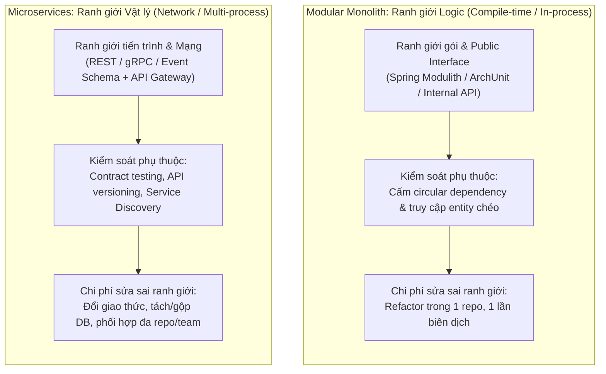
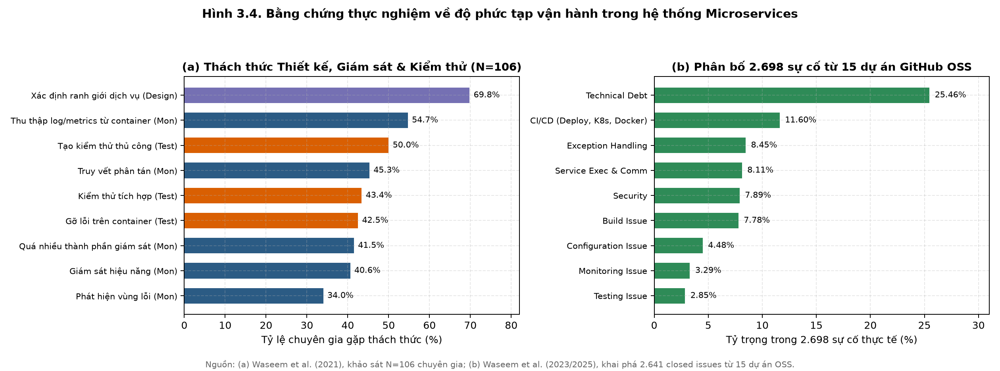
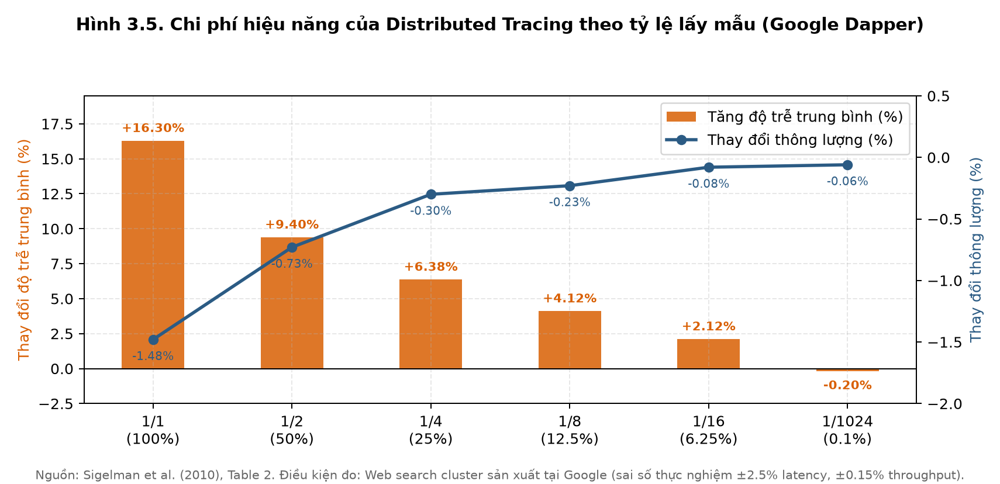
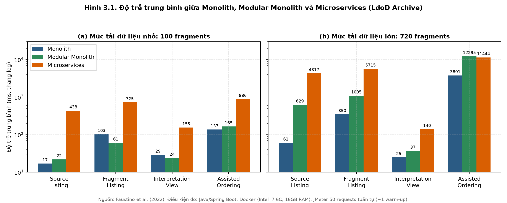
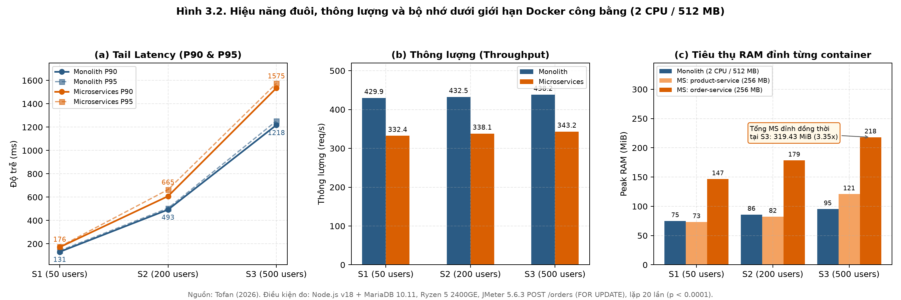
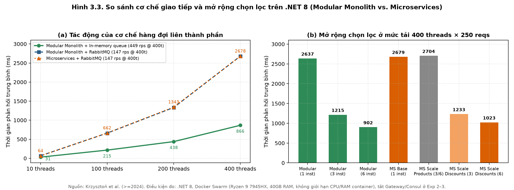
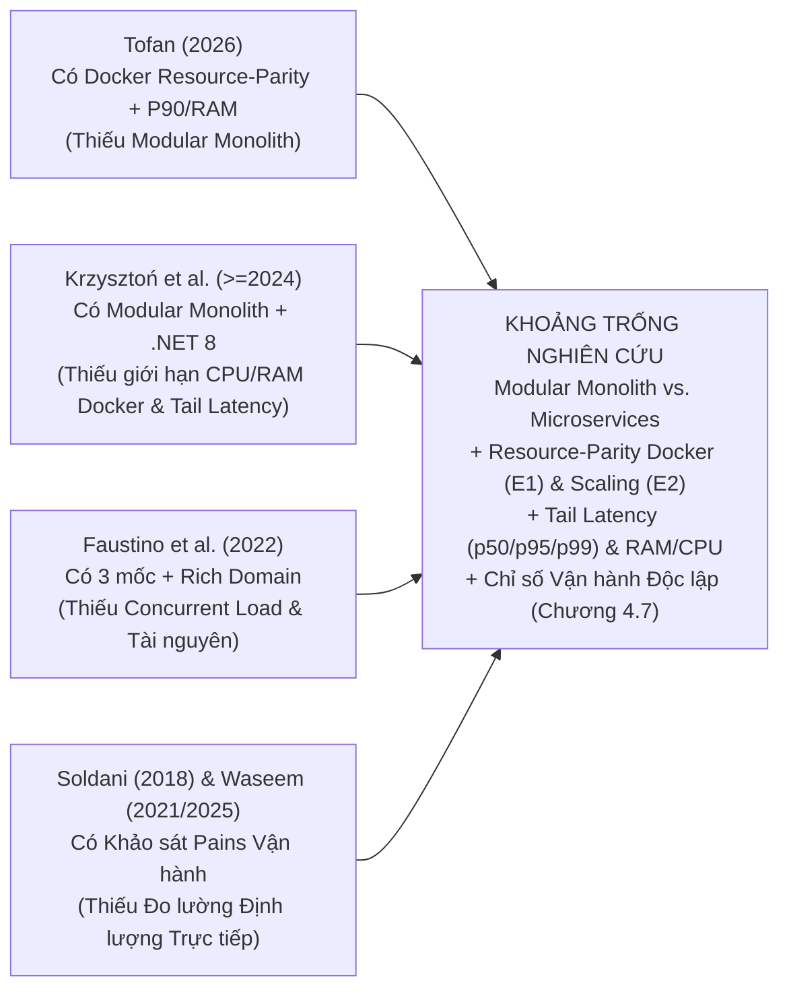

# CHƯƠNG 3. TỔNG QUAN NGHIÊN CỨU VÀ PHÂN TÍCH SO SÁNH

Chương này đóng vai trò cầu nối học thuật giữa hệ thống nguyên lý nền tảng ở Chương 2 và thiết kế thực nghiệm có kiểm soát ở Chương 4. Thay vì chỉ liệt kê tóm tắt từng bài báo, nội dung được triển khai theo hướng **phân tích đối chứng đa chiều**: (1) hệ thống hóa bốn nhánh nghiên cứu liên quan cùng các trục lý thuyết cần thiết để lý giải sự khác biệt giữa **Modular Monolith** và **Microservices**; (2) phân tích sâu sự đánh đổi về thiết kế cấu trúc, tính toàn vẹn dữ liệu, độ phức tạp vận hành và hiệu năng dựa trên các số liệu định lượng trích xuất từ công trình đã công bố (kèm biểu đồ trực quan hóa điều kiện đo); và (3) xác lập khoảng trống nghiên cứu cùng năm giả thuyết cần kiểm định.

---

## 3.1. Tổng quan các Nghiên cứu Liên quan và Khung Lý thuyết Bổ trợ

Qua rà soát 20 tài liệu khoa học và kỹ thuật trong cơ sở dữ liệu nghiên cứu, các công trình liên quan đến bài toán so sánh kiến trúc *backend* phát triển theo bốn nhánh rõ rệt, phản ánh sự dịch chuyển nhận thức từ "ưu tiên mở rộng phân tán" sang "đánh giá đánh đổi dựa trên bằng chứng":

1. **Nhánh nghiên cứu về Modular Monolith và lộ trình chuyển đổi từng bước (*Stepwise Migration*):** Công trình tổng quan tài liệu xám có hệ thống của Su và Li (2024) trên **64 tài liệu công nghiệp** (2019–2023) là tài liệu nền tảng đầu tiên chuẩn hóa khái niệm Modular Monolith thông qua 6 đặc trưng, 9 tính chất, 3 framework tiêu biểu (*Service Weaver*, *Spring Modulith*, *Light-hybrid-4j*) và 4 nghiên cứu trường hợp tại doanh nghiệp (*Shopify*, *Appsmith*, *Gusto*, *PlayTech*). Ở chiều định lượng, Faustino và các cộng sự (2022) thực hiện nghiên cứu trường hợp trên hệ thống sản xuất *LdoD Archive* (Java/Spring Boot, 71 thực thể miền, 81 quan hệ hai chiều) nhằm đo lường đồng thời công sức tái cấu trúc (*migration effort*) và suy giảm hiệu năng qua ba mốc: Monolith $\rightarrow$ Modular Monolith $\rightarrow$ Microservices.
2. **Nhánh thực nghiệm đối chứng hiệu năng và tài nguyên:** Giai đoạn 2020–2026 chứng kiến sự cải thiện rõ rệt về độ chặt chẽ của thiết kế thực nghiệm. Các nghiên cứu sớm như Tapia và các cộng sự (2020) hay Wahyudin và các cộng sự (2025) cho thấy Microservices đạt thông lượng cao hơn nhưng tồn tại biến gây nhiễu nghiêm trọng do khác biệt nền tảng triển khai (KVM so với Docker) hoặc khác biệt ngôn ngữ và giao thức (PHP Laravel so với Golang gRPC). Ngược lại, Blinowski và các cộng sự (2022) trên Java 8/C# 8, Tofan (2026) trên Node.js v18 (giới hạn Docker `2 CPU / 512 MB`), và Krzysztoń và các cộng sự ($\ge 2024$) trên `.NET 8` đã giữ được **tính tương đồng công nghệ (*tech-stack parity*)**, qua đó bóc tách chính xác chi phí giao tiếp mạng, tuần tự hóa và bộ nhớ nền của Microservices.
3. **Nhánh đánh giá khả năng mở rộng và chi phí hạ tầng đám mây:** Villamizar và các cộng sự (2015; 2017) triển khai ứng dụng SaaS gồm hai dịch vụ có đặc tính tải bất đối xứng (`S1` nặng CPU $\approx 3.000\text{ ms}$ và `S2` nặng CSDL $\approx 300\text{ ms}$) lên AWS EC2 và AWS Lambda để đo *Cost per Million Requests* (CMR). Song song đó, Blinowski và các cộng sự (2022) khảo sát 1 đến 20 *instances* trên Azure App Service để chỉ ra điểm bão hòa và hiện tượng *over-scaling* khi mở rộng ngang.
4. **Nhánh nghiên cứu thực nghiệm về độ phức tạp vận hành:** Soldani và các cộng sự (2018) tổng hợp **51 nghiên cứu công nghiệp** nhằm đối chiếu lợi ích (*Gains*) và nỗi đau (*Pains*) của Microservices; Söylemez và các cộng sự (2022) hệ thống hóa **85 bài báo học thuật** (từ 3.842 bài ban đầu) thành 9 nhóm thách thức vận hành (`P1`–`P9`); còn Waseem và các cộng sự (2021; 2023/2025) kết hợp khảo sát chuyên gia ($N=106$ và $N=150$), phỏng vấn sâu ($N=6$ và $N=15$) và khai phá **2.641 sự cố trên GitHub** từ 15 dự án mã nguồn mở để định lượng tỷ trọng lỗi CI/CD, cấu hình, giám sát và gỡ lỗi container.

### Các trục lý thuyết bổ trợ cần tích hợp khi phân tích kết quả
Để không dừng lại ở việc mô tả số liệu đơn thuần của các nhánh trên, việc lý giải sự đánh đổi giữa Modular Monolith và Microservices đòi hỏi phối hợp năm trục lý thuyết bổ trợ đã thiết lập ở Chương 2:
- **Lý thuyết che giấu thông tin (*Information Hiding*, Parnas 1972/2001):** Giải thích vì sao chi phí tách phụ thuộc đã xuất hiện ngay ở bước Modular Monolith và vì sao việc gắn chặt mô-đun với tiến trình riêng gây *overhead* khi không cần song song hóa.
- **Định lý CAP (Gilbert và Lynch, 2002) và Mô hình Saga (Garcia-Molina và Salem, 1987):** Lý giải nguyên nhân lý thuyết buộc Microservices phải từ bỏ khóa ACID toàn cục (do bế tắc tăng theo $\text{size}^4$) để đánh đổi lấy *Eventual Consistency* và giao dịch bù trừ.
- **Khuếch đại độ trễ đuôi (*Tail Latency Amplification*, Dean và Barroso, 2013):** Giải thích cơ chế xác suất khiến một tỷ lệ chậm nhỏ ở từng microservice bị khuếch đại thành suy giảm `p95`/`p99` nghiêm trọng khi có *fan-out* hoặc *API Composition*.
- **Định luật Little ($L = \lambda \cdot W$) và Lý thuyết hàng đợi:** Giải thích vì sao cùng một tốc độ tải đến ($\lambda$), sự gia tăng thời gian xử lý ($W$) do qua *API Gateway* hoặc *Message Broker* làm phình hàng đợi và giảm thông lượng bão hòa.
- **Chi phí quan sát (*Observability Overhead*, Sigelman và các cộng sự, 2010):** Giải thích cái giá hiệu năng và hạ tầng của *Distributed Tracing* trong môi trường nhiều container.

---

## 3.2. So sánh về Thiết kế, Ranh giới Mô-đun và Cấu trúc Hệ thống

Sự khác biệt cấu trúc giữa hai kiến trúc nằm ở nơi đặt **ranh giới nghiệp vụ (*Bounded Context*)** và cơ chế cưỡng chế ranh giới đó trong mã nguồn cũng như lúc thực thi:

- **Định nghĩa ranh giới và hiệu ứng dây chuyền:** Khảo sát của Waseem và các cộng sự (2021) trên 106 chuyên gia ghi nhận thách thức thiết kế lớn nhất của Microservices là *xác định rõ ràng ranh giới dịch vụ* (**69,8%**, 74/106). Đáng chú ý, ranh giới thiếu rõ ràng không chỉ dừng ở giai đoạn thiết kế mà còn lan truyền sang vận hành: **59,4%** người tham gia khẳng định nó làm phức tạp hóa hoạt động giám sát và **54,7%** cho biết nó gây khó khăn trực tiếp cho kiểm thử. Tương tự, Soldani và các cộng sự (2018) ghi nhận **27/51** tài liệu công nghiệp coi quy mô và độ phức tạp kiến trúc là nỗi đau hàng đầu, kèm theo bài toán định cỡ dịch vụ (*service dimensioning*, **16/51**) và quản lý phiên bản API (*API versioning*, **13/51**).
- **Công sức tái cấu trúc khi tách ranh giới (*Migration Effort*):** Thực nghiệm của Faustino và các cộng sự (2022) trên *LdoD Archive* cung cấp bằng chứng định lượng hiếm hoi tách bạch chi phí của hai bước chuyển đổi:
  - *Bước 1 (Monolith $\rightarrow$ Modular Monolith):* Để cắt bỏ 81 quan hệ hai chiều và ẩn giấu thực thể miền theo đúng tinh thần Parnas, nhóm tác giả phải chỉnh sửa **40%–82%** tổng số thực thể tùy mô-đun (`Virtual`: 14/17 = 82%, `Game`: 3/5 = 60%, `Text`: 23/42 = 55%, `Recommendation`: 1/2 = 50%, `User`: 2/5 = 40%), định nghĩa mới DTOs (như `Virtual` 7/17 = 41%) và gỡ bỏ tới 83%–100% quan hệ trực tiếp ở các mô-đun nhỏ (`Recommendation` 2/2, `Game` 5/6).
  - *Bước 2 (Modular Monolith $\rightarrow$ Microservices):* Tỷ lệ phương thức phải sửa trên *provides/requires interfaces* rất cao (**83%–100%** ở các mô-đun), nhưng bản chất chủ yếu là thao tác ánh xạ lặp lại từ lời gọi hàm sang HTTP *endpoints*. Chi phí phát sinh thực sự chỉ xuất hiện khi gặp tham số phức tạp không phù hợp truyền qua HTTP body hoặc cấu trúc dữ liệu không tuần tự hóa được trong DTO (như mô-đun `Recommendation`).
  - **Nhận định phân tích (`A1`):** Kết quả của Faustino cho thấy phần khó nhất về mặt thiết kế miền (tách ghép nối dữ liệu) đã được giải quyết ngay ở Modular Monolith với chi phí *refactor* nội bộ thấp hơn nhiều so với việc sửa sai ranh giới sau khi đã tách thành các microservice độc lập — điều giải thích vì sao doanh nghiệp *Gusto* (Su và Li, 2024) chọn Modular Monolith để tránh chi phí sửa sai *service boundary*.
- **Khả năng mở rộng đội ngũ và tự do công nghệ:** Ở chiều ngược lại, Microservices mang lại lợi thế rõ rệt khi tổ chức có nhiều nhóm độc lập: Soldani và các cộng sự (2018) ghi nhận **27/51** tài liệu đánh giá cao tính *loose coupling*, **24/51** nhấn mạnh *bounded contexts* và *technology freedom*, cùng **19/51** ghi nhận lợi ích *independent deployment*. Tuy nhiên, nếu quy mô đội ngũ chỉ ở mức vừa hoặc nhỏ (như trường hợp *PlayTech Casino Backend Team* hoặc *Appsmith* triển khai *on-premise*), Modular Monolith vẫn duy trì được ranh giới phát triển song song (như *Shopify* vận hành >1.000 lập trình viên trên một kho mã nguồn) mà không gánh chi phí duy trì đa kho mã nguồn và đa ngôn ngữ.

---

## 3.3. So sánh về Tính Toàn vẹn và Nhất quán Dữ liệu

Sự chuyển dịch từ cơ sở dữ liệu dùng chung có phân tách *schema* (Modular Monolith) sang mô hình *Database per Service* (Microservices) tạo ra một trong những đánh đổi sâu sắc nhất về mặt kỹ thuật:

| Tiêu chí dữ liệu | Modular Monolith (Shared DB / Schema cô lập) | Microservices (Database per Service) | Cơ sở lý thuyết & Bằng chứng |
| :--- | :--- | :--- | :--- |
| **Mô hình nhất quán** | **Strong Consistency (ACID)** trong một giao dịch cục bộ | **Eventual Consistency (BASE)**; chọn CP hoặc AP khi có phân mảnh | Định lý CAP (Gilbert & Lynch, 2002); AWS Guidance (2021–2025) |
| **Giao dịch đa thành phần** | Một *local transaction*; lỗi ở bước cuối tự động *rollback* toàn bộ | Phải dùng **Saga Pattern** ($T_1 \dots T_n$ + $C_i$), **Outbox** và **Idempotency** | Garcia-Molina & Salem (1987): global lock làm deadlock $\propto \text{size}^4$ |
| **Tính cô lập (*Isolation*)** | Đạt *Serializable / Repeatable Read* chuẩn DBMS | Mất isolation tầng ngoài (*two-level nesting*); lộ trạng thái trung gian | Garcia-Molina & Salem (1987); Soldani et al. (`21/51` consistency, `18/51` dist. tx) |
| **Truy vấn tổng hợp** | Truy vấn trong cùng DBMS (qua API nội bộ hoặc view cô lập) | Phải dùng **API Composition** (giảm *availability* khi chuỗi dài) hoặc **CQRS** | Ward & Mohan / AWS (2021–2025); Soldani et al. (`9/51` query complexity) |
| **Rủi ro ghép nối (*Coupling*)** | Rủi ro *dev-time coupling* (đổi schema) & *runtime lock* (bảng nóng) | Cô lập kho dữ liệu, hỗ trợ *polyglot persistence*, nhưng khó gỡ lỗi Saga | AWS Guidance (2021–2025); Faustino et al. (2022) Table V |

Phân tích sâu từ trường hợp *LdoD Archive* (Faustino và các cộng sự, 2022) cho thấy một sắc thái quan trọng: không phải mọi nghiệp vụ phân tán đều bắt buộc phải dùng Saga phức tạp ngay lập tức. Khi phân tích 8 loại sự kiện thay đổi dữ liệu trong phiên bản Microservices, nhóm tác giả nhận thấy các sự kiện xóa ở mô-đun `Text` và `User` có tác động lan truyền cao (ảnh hưởng nhiều CSDL và kích hoạt chuỗi sự kiện dây chuyền) nhưng tần suất xảy ra thấp (`Low`), trong khi sự kiện ở `Virtual` có tần suất trung bình (`Medium`) nhưng chỉ ảnh hưởng `Game`. Do đó, *eventual consistency* thông qua hàng đợi sự kiện đủ đáp ứng cho hệ thống ít thao tác ghi chéo. Tuy nhiên, với **luồng xử lý đơn hàng** có tính nhạy cảm cao về tồn kho (`Inventory`) và thanh toán (`Payment`) — như bài toán đặt hàng đồng bộ dùng khóa dòng `SELECT ... FOR UPDATE` trong nghiên cứu của Tofan (2026) — việc tách sang Microservices buộc hệ thống phải đánh đổi giữa khóa bi quan cục bộ (gây nghẽn hàng đợi) hoặc triển khai Saga hoàn chỉnh kèm giao dịch bù trừ, làm tăng trực tiếp cả độ trễ xử lý lẫn độ phức tạp kiểm thử.

---

## 3.4. So sánh về Độ phức tạp Vận hành

Nếu ở phần thiết kế và dữ liệu, Microservices vẫn có những ưu thế nhất định về tính tự chủ, thì ở khía cạnh vận hành thực tế, cả bốn công trình thuộc Nhóm 3 đều chỉ ra sự gia tăng gánh nặng rõ rệt của Microservices so với kiến trúc nguyên khối.

Như minh họa ở **Hình 3.4**, dữ liệu từ hai nghiên cứu thực nghiệm quy mô lớn của Waseem và các cộng sự (2021; 2023/2025) cho thấy hai mặt bổ sung của độ phức tạp vận hành:
1. **Áp lực giám sát, truy vết và kiểm thử từ góc nhìn chuyên gia ($N=106$, Hình 3.4a):** Có tới **54,7%** chuyên gia gặp khó khăn khi thu thập *metrics* và *logs* từ các container phân tán; **45,3%** gặp trở ngại với *distributed tracing*; **41,5%** gặp áp lực do số lượng thành phần cần giám sát quá lớn; và **34,0%** gặp khó khăn trong việc phát hiện vùng lỗi (*failure zone detection*). Ở khâu kiểm chứng chất lượng, **43,4%** gặp khó khi kiểm thử tích hợp liên dịch vụ và **42,5%** gặp khó khi gỡ lỗi (*debugging*) trực tiếp trên nền tảng container. Đáng chú ý, **74,5%** người tham gia khảo sát chưa từng được đào tạo bài bản về MSA, làm khuếch đại chi phí vận hành thực tế trong doanh nghiệp.
2. **Phân bố sự cố thực tế trên 15 dự án mã nguồn mở (2.698 instances, Hình 3.4b):** Khai phá 2.641 *closed issues* cho thấy ngoài nợ kỹ thuật (*Technical Debt*, **25,46%**), các nhóm lỗi mang đậm dấu ấn phân tán và vận hành chiếm tỷ trọng rất lớn: lỗi **CI/CD** (triển khai, Kubernetes, Docker) đứng thứ hai với **11,60%** (313 sự cố), tiếp theo là xử lý ngoại lệ liên dịch vụ (**8,45%**), thực thi và giao tiếp dịch vụ (**8,11%**), bảo mật (**7,89%** — mở rộng bề mặt tấn công theo từng *endpoint*), lỗi *build* (**7,78%**) và lỗi cấu hình (**4,48%**). Khi phân tích **2.267 nguyên nhân gốc**, sai lệch cấu hình và giao tiếp chiếm tới **16,85%** (riêng cấu hình sai chiếm 12,79%) và xung đột phiên bản/phụ thuộc cũ chiếm **9,79%**. Khi đối chiếu lại bằng khảo sát xác thực trên **150 chuyên gia** từ 42 quốc gia, tỷ lệ gặp phải ở mức thường xuyên (*Often/Very Often*) lên tới **82,67%** đối với vấn đề bảo mật và tổ chức, và **69,34%** đối với lỗi CI/CD.

Bên cạnh gánh nặng cấu hình và quy trình, **Hình 3.5** trích xuất từ nghiên cứu kinh điển về hệ thống *Dapper* tại Google (Sigelman và các cộng sự, 2010) chứng minh rằng ngay cả công cụ dùng để giải quyết bài toán quan sát trong Microservices cũng tạo ra chi phí hiệu năng đo đếm được. Khi bật truy vết phân tán cho 100% yêu cầu (`1/1` sampling) trên cụm tìm kiếm web, **độ trễ trung bình tăng thêm +16,30%** và **thông lượng giảm -1,48%**. Chỉ khi hạ tỷ lệ lấy mẫu xuống `1/16`, mức tăng độ trễ mới giảm về **+2,12%** (nằm trong biên sai số thực nghiệm $\pm 2{,}5\%$), và tiến tới gần như bằng 0 ở `1/1024` (`-0,20%`). Điều này cho thấy một nghịch lý vận hành: Modular Monolith có thể theo dõi luồng xử lý nội bộ với chi phí gần như không đáng kể, trong khi Microservices bắt buộc phải đầu tư hạ tầng thu thập dấu vết *out-of-band* (như Dapper, Zipkin hoặc Jaeger) nhưng vẫn phải chấp nhận đánh đổi giữa độ chi tiết giám sát và hiệu năng xử lý.

---

## 3.5. So sánh về Hiệu năng, Khả năng Mở rộng và Sử dụng Tài nguyên

Đối chiếu tám nghiên cứu thực nghiệm thuộc Nhóm 2 cùng thực nghiệm *LdoD Archive* (Nhóm 1) cho thấy hiệu năng của Modular Monolith và Microservices không tuân theo một kết luận tuyệt đối, mà biến thiên mạnh theo bốn điều kiện: cơ chế giao tiếp, giới hạn tài nguyên trên một nút, tính đối xứng của tải và cách kiểm soát biến gây nhiễu.

### 3.5.1. Chi phí ranh giới mô-đun (DTO) so với chi phí mạng và tuần tự hóa

Số liệu từ thực nghiệm của Faustino và các cộng sự (2022) trên **Hình 3.1** bóc tách rõ hai tầng suy giảm hiệu năng khi phân rã một hệ thống *rich domain model*:
- **Tác động của đóng gói mô-đun (Modular Monolith):** Ở mức tải dữ liệu nhỏ (100 *fragments*), Modular Monolith thậm chí đạt độ trễ thấp hơn Monolith gốc ở tác vụ *Fragment Listing* (`61 ms` so với `103 ms`, giảm `41%`) và *Interpretation View* (`24 ms` so với `29 ms`) nhờ tối ưu hóa chỉ mục CSDL cho các định danh duy nhất (*unique IDs*). Tuy nhiên, khi kích thước dữ liệu tăng lên **720 fragments** ở *Source Listing*, độ trễ của Modular Monolith tăng từ `61 ms` (Monolith) lên `629 ms` (`+931%`) do chi phí tạo và ánh xạ số lượng lớn DTO qua ranh giới mô-đun.
- **Tác động cộng dồn của mạng và tuần tự hóa (Microservices):** Khi tách thành các tiến trình giao tiếp qua HTTP/REST, độ trễ của Microservices vọt lên `438 ms` (100 *fragments*) và `4.317 ms` (720 *fragments*) ở *Source Listing* (thông lượng giảm **-96% đến -99%** so với Monolith), và lên tới `5.715 ms` ở *Fragment Listing*. Đáng chú ý, ngay cả sau khi đã áp dụng chiến lược *coarse-grained DTO* để giảm số lần gọi mạng, **quá trình tuần tự hóa và giải tuần tự hóa vẫn chiếm tới 82% tổng độ trễ trung bình** (hơn `3.000 ms` cho *serialization* và `560 ms` cho *deserialization*).

### 3.5.2. Hiệu năng đuôi (Tail Latency) và chi phí bộ nhớ dưới giới hạn tài nguyên Docker

Để đánh giá công bằng trên một máy chủ vật lý, thực nghiệm của Tofan (2026) cố định tổng ngân sách tài nguyên tầng ứng dụng là **2 CPU và 512 MB RAM** cho cả Monolith (`2.0 CPU / 512 MB`) và Microservices (`1.0 CPU / 256 MB` mỗi dịch vụ `product-service` và `order-service`), cùng dùng chung Node.js v18 và MariaDB 10.11. Như thể hiện trên **Hình 3.2**, mọi khác biệt đều có ý nghĩa thống kê rất cao ($p < 0{,}0001$, Cliff's $|\delta| = 1{,}000$):
- **Độ trễ đuôi (`P90`, `P95`) và Thông lượng:** Khi tải tăng từ 50 lên 500 người dùng ảo (`S1` $\rightarrow$ `S3`), phân vị `P90` của Microservices luôn cao hơn Monolith khoảng **21%–30,5%** (`171,38` so với `131,35 ms` ở `S1`; `608,11` so với `492,70 ms` ở `S2`; `1.534,50` so với `1.217,60 ms` ở `S3`), kéo theo `P95` ở `S3` lên tới `1.574,56 ms` (so với `1.252,80 ms` của Monolith). Tương ứng theo Định luật Little, thông lượng của Microservices bị kìm hãm ở mức `332,38–343,24 req/s`, thấp hơn **21,7%–22,7%** so với `429,89–438,25 req/s` của Monolith.
- **Chi phí bộ nhớ nền (*Memory Overhead*):** Tại kịch bản `S3` (500 người dùng), Monolith chỉ tiêu thụ đỉnh **95,31 MiB** RAM, trong khi tổng RAM đỉnh đồng thời của hai microservice đạt **319,43 MiB (gấp 3,35 lần)**. Riêng `order-service` chạm mức `218,01 MiB` (chiếm khoảng **86%** giới hạn `256 MB` được cấp), cho thấy phân mảnh ngân sách bộ nhớ theo từng container làm tăng mạnh nguy cơ chạm ngưỡng *OOM/throttling* ngay cả khi tổng RAM toàn máy còn dư.

### 3.5.3. Tác động của cơ chế hàng đợi và khả năng mở rộng chọn lọc

Nghiên cứu trên `.NET 8` của Krzysztoń và các cộng sự ($\ge 2024$) bổ sung góc nhìn trực tiếp về **Modular Monolith** trong hai kịch bản then chốt (**Hình 3.3**):
- **Hàng đợi nội bộ so với Message Broker ngoài (Hình 3.3a):** Ở tác vụ tính giảm giá giỏ hàng với 400 *threads*, Modular Monolith sử dụng *in-memory queue* đạt thời gian phản hồi trung bình **866 ms** và thông lượng **449 req/s**. Khi chuyển sang dùng *RabbitMQ*, cả Modular Monolith (`2.680 ms / 147 req/s`) lẫn Microservices (`2.678 ms / 147 req/s`) đều chậm hơn khoảng **3 lần** và cho kết quả gần như trùng khít nhau. Điều này chứng minh rằng nếu thiết kế Modular Monolith vẫn phụ thuộc vào *broker* mạng ngoài thay vì *in-memory bus*, lợi thế hiệu năng nội bộ sẽ bị triệt tiêu bởi chi phí I/O mạng của *broker*.
- **Mở rộng chọn lọc (*Selective Scaling*, Hình 3.3b):** Tại tải 400 *threads*, việc mở rộng đồng loạt Modular Monolith từ 1 lên 3 và 6 *instances* giảm độ trễ từ `2.637 ms` xuống `1.215 ms` và `902 ms`. Trong Microservices, việc mở rộng nhầm dịch vụ ít tải (`Products`) giữ nguyên độ trễ ở `2.704 ms`; ngược lại, chỉ cần mở rộng riêng dịch vụ nghẽn cổ chai (`Discounts`) lên 3 và 6 *instances* đã hạ độ trễ xuống `1.233 ms` và `1.023 ms` — tiệm cận mức mở rộng toàn bộ Monolith mà không lãng phí tài nguyên cho các thành phần khác.

Kết quả này tương đồng với hai nghiên cứu đám mây của Villamizar và các cộng sự (2015; 2017) trên AWS: khi hai dịch vụ có tải bất đối xứng (`S1` nặng CPU, `S2` nặng CSDL), việc cấp phát máy ảo khớp từng dịch vụ giúp Microservices tiết kiệm **17%** chi phí tháng (2015) và **9,50%–13,81%** chi phí trên mỗi triệu yêu cầu (2017), dù độ trễ trung bình vẫn cao hơn Monolith do bước nhảy qua *API Gateway*. Tuy nhiên, Blinowski và các cộng sự (2022) trên Azure App Service cũng cảnh báo giới hạn của mở rộng ngang: khi tăng từ 6 lên 15–20 *instances*, hiệu năng có thể chững lại hoặc suy giảm (*over-scaling*), trong khi mở rộng dọc (*vertical scaling*) thường đạt hiệu quả chi phí tốt hơn ở quy mô vừa.

### 3.5.4. Phê bình phương pháp luận: Vai trò của kiểm soát biến gây nhiễu
Một bài học quan trọng rút ra khi đối chiếu Nhóm 2 là **nhiễu công nghệ và nền tảng triển khai** có thể đảo ngược hoàn toàn kết luận kiến trúc. Cụ thể, Tapia và các cộng sự (2020) ghi nhận Microservices đạt thông lượng cao hơn Monolith (`3,1` so với `2,5 req/s`), nhưng lại chạy Monolith trên máy ảo **KVM** (có *overhead* của *hypervisor*) trong khi chạy Microservices trên **Docker Compose** ở mức tải quá thấp (3–5 *threads*). Tương tự, Wahyudin và các cộng sự (2025) báo cáo Microservices nhanh gấp hơn 7 lần Monolith (`154 ms` so với `1.138 ms`), nhưng thực chất đang so sánh **Golang + gRPC** với **PHP Laravel**. Do đó, thiết kế thực nghiệm ở Chương 4 bắt buộc phải khóa chặt *tech-stack parity* và *deployment parity*.

---

## 3.6. Tổng hợp Kết quả từ các Nghiên cứu Trước

Bảng dưới đây tổng hợp các công trình thực nghiệm và khảo sát tiêu biểu làm cơ sở đối chứng (loại bỏ Desina, 2023 khỏi bằng chứng định lượng do thiếu *baseline* Monolith và có sai sót tính toán nội tại).

| Nghiên cứu | Phương pháp | Điều kiện đo / Mẫu | Chỉ số đánh giá | Kết quả chính | Hạn chế |
| :--- | :--- | :--- | :--- | :--- | :--- |
| **Faustino et al. (2022)** | Case study thực nghiệm (*LdoD Archive*) | Java/Spring Boot, Docker (i7 6C, 16GB), JMeter 50 req tuần tự (100 & 720 fragments) | Migration effort, Latency, Throughput | Sửa 40%–82% entities lên Modular; MS chậm hơn mạnh (*serialization* chiếm 82% latency ở Source Listing) | Chỉ 1 case *rich domain model*; chưa chạy tải đồng thời & đo CPU/RAM |
| **Blinowski et al. (2022)** | Thực nghiệm có kiểm soát | Java 8 & C# 8 (không DB), Local + Azure (1–20 inst), JMeter 10 threads | Throughput, Cost-efficiency | Monolith thắng trên 1 máy & ở cùng chi phí hạ tầng; *over-scaling* 15–20 inst làm giảm throughput | Không có DB; không giao tiếp liên dịch vụ; không đo latency & CPU |
| **Tofan (2026)** | Thực nghiệm kiểm soát + thống kê | Node.js v18 + MariaDB, Docker **2 CPU / 512 MB**, JMeter (50/200/500 users, 60s × 20 lần) | P90/P95, Throughput, RAM, CPU | Monolith P90 thấp hơn 21%–24%, throughput cao hơn 28%–29%, RAM thấp hơn **3,35x** ($p < 0{,}0001$) | Monolith truyền thống (không phải Modular); chỉ 2 service đồng bộ |
| **Krzysztoń et al. ($\ge 2024$)** | Thực nghiệm có kiểm soát (3 Exp) | .NET 8 + PG/Mongo/RabbitMQ/Consul, Docker Swarm (40GB RAM), JMeter | Avg RT, Throughput | Modular + *in-memory queue* nhanh **~3x** RabbitMQ; MS thắng ở *selective scaling* dịch vụ nghẽn | **Không giới hạn CPU/RAM Docker**; tắt Gateway/Consul ở Exp 2–3; không đo tail latency |
| **Villamizar et al. (2015, 2017)** | Triển khai Cloud đối chứng | Play/Java & AWS Lambda (Node.js) + PostgreSQL RDS, JMeter 10 phút | SLA RT, Chi phí/tháng, CMR | MS giảm 9,5%–17% chi phí (Lambda giảm 50%–77%) khi tải không đồng đều, nhưng ART cao hơn Mono | Chỉ 2 service; Lambda khác ngôn ngữ; phụ thuộc bảng giá AWS 2015 |
| **Su & Li (2024)** | Systematic Grey Literature Review | 64 tài liệu công nghiệp (2019–2023) | Định nghĩa, Frameworks, Industry cases | Hệ thống hóa 6 đặc trưng Modular Monolith; 4 doanh nghiệp chọn Modular để giảm gánh nặng vận hành | Không phải benchmark hiệu năng; thiếu mục *Threats to validity* |
| **Waseem et al. (2021, 2023/2025)** | Survey + Interview + GitHub Mining | $N=106$ & $N=150$ surveys; 2.641 OSS issues (15 dự án) | Tần suất thách thức & nguyên nhân lỗi | 54,7% khó thu thập log/metrics container; 45,3% khó tracing; 11,60% CI/CD issues; 16,85% lỗi cấu hình/giao tiếp | Dữ liệu mining lệch về dự án OSS lớn; tỷ lệ phản hồi survey 2021 thấp (1,5%) |
| **Soldani et al. (2018)** & **Söylemez et al. (2022)** | GLR (51 studies) & SLR (85 studies) | Tài liệu công nghiệp (2014–2017) & 5 CSDL học thuật (2014–2022) | Pains/Gains, Taxonomy 9 nhóm thách thức | Thống nhất gánh nặng lớn nhất ở vận hành, nhất quán dữ liệu, giám sát và điều phối container | Thiếu công cụ định lượng trực tiếp mức độ "đau" vận hành |

---

## 3.7. Khoảng trống Nghiên cứu (Research Gap)

Giao điểm giữa các kết quả và hạn chế ở Mục 3.6 cho thấy bốn khoảng trống nghiên cứu rõ rệt mà đề tài này hướng tới giải quyết:

1. **Chưa có đối chiếu trực tiếp Modular Monolith và Microservices trong điều kiện cân bằng tài nguyên (*Resource Parity*):** Tofan (2026) áp đặt giới hạn Docker rất chặt (`2 CPU / 512 MB`) nhưng chỉ thử nghiệm Monolith truyền thống; trong khi Krzysztoń và các cộng sự ($\ge 2024$) so sánh đúng Modular Monolith với Microservices nhưng lại bỏ trống giới hạn CPU/RAM container và tắt *API Gateway/Consul* ở 2/3 kịch bản.
2. **Tách rời giữa đo hiệu năng và định lượng độ phức tạp vận hành:** Các nghiên cứu benchmark (Nhóm 2) chưa đo các chỉ số vận hành như thời gian dựng môi trường, số lượng tệp cấu hình hay thời gian khoanh vùng lỗi khi tiêm sự cố; ngược lại, các nghiên cứu vận hành (Nhóm 3) mới dừng ở thống kê tần suất khảo sát mà thiếu thước đo thực nghiệm (Soldani và các cộng sự, 2018).
3. **Thiếu luồng nghiệp vụ xử lý giao dịch đa thành phần có kịch bản lỗi:** Nhiều benchmark trước đây dùng *endpoint* không có CSDL (Blinowski và các cộng sự, 2022) hoặc chỉ đọc dữ liệu đơn giản, chưa phản ánh đủ chi phí kiểm soát nhất quán dữ liệu và cô lập lỗi trong một luồng nghiệp vụ hoàn chỉnh.

---

## 3.8. Đề xuất Mô hình Phân tích và Giả thuyết Nghiên cứu

Trên cơ sở lý thuyết (Chương 2) và các khoảng trống nghiên cứu vừa xác lập (Mục 3.7), đề tài đề xuất mô hình thực nghiệm đối chứng giữ cố định ngăn xếp công nghệ (*tech-stack parity*), nền tảng Docker (*deployment parity*) và luồng nghiệp vụ xử lý đơn hàng gồm 4 thành phần (`Order`, `Inventory`, `Payment`, `Notification`), triển khai trên hai chế độ **`E1 – Resource Parity`** và **`E2 – Scaling Evaluation`**. Năm giả thuyết nghiên cứu cần kiểm định ở Chương 5 gồm:

- **$H_1$ (Hiệu năng độ trễ và thông lượng):** Trong điều kiện chạy trên cùng máy chủ với tổng giới hạn tài nguyên tương đương (`E1`), Modular Monolith đạt độ trễ phân vị (`p50`, `p95`, `p99`) thấp hơn và thông lượng (`RPS`) cao hơn Microservices nhờ loại bỏ chi phí mạng và tuần tự hóa liên dịch vụ.
- **$H_2$ (Tiêu thụ tài nguyên nền):** Dưới cùng mức tải và giới hạn tài nguyên, Microservices tiêu thụ bộ nhớ RAM nền và tổng mức RAM đỉnh cao hơn Modular Monolith do nhân bản nhiều tiến trình *runtime*, *API Gateway* và các *connection pool* tách biệt.
- **$H_3$ (Độ phức tạp triển khai và vận hành):** Microservices có độ phức tạp vận hành cao hơn trên từng chỉ số độc lập: số lượng đơn vị triển khai, khối lượng tệp cấu hình, thời gian build/dựng môi trường và thời gian khoanh vùng dịch vụ lỗi khi tiêm sự cố (*Fault Injection*).
- **$H_4$ (Khả năng mở rộng chọn lọc):** Trong chế độ mở rộng có chọn lọc (`E2`) khi tải dồn vào một thành phần nghẽn cổ chai, Microservices cho phép tăng số *instance* riêng cho dịch vụ đó để cải thiện thông lượng mà không phải nhân bản các thành phần nhàn rỗi như Modular Monolith.
- **$H_5$ (Chi phí đảm bảo nhất quán dữ liệu):** Khi xử lý kịch bản thất bại cần hoàn tác ở bước thanh toán/tồn kho, Microservices phát sinh thêm chi phí độ trễ và độ phức tạp cài đặt cơ chế bù trừ (*Saga / Outbox / Idempotency*) so với giao dịch ACID cục bộ của Modular Monolith.

> [!NOTE]
> Toàn bộ năm giả thuyết $H_1 \dots H_5$ trên là **dự đoán khoa học được suy diễn có căn cứ**, chưa phải kết luận đã chứng minh. Việc bác bỏ hay chấp nhận từng giả thuyết sẽ được thực hiện dựa trên dữ liệu đo thực tế và kiểm định thống kê ở Chương 5.
