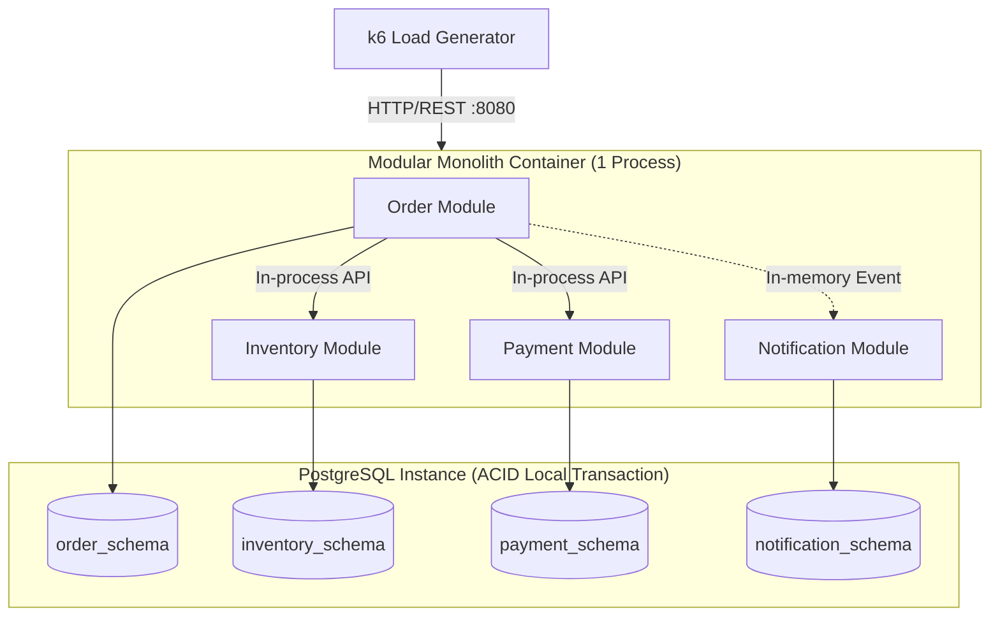
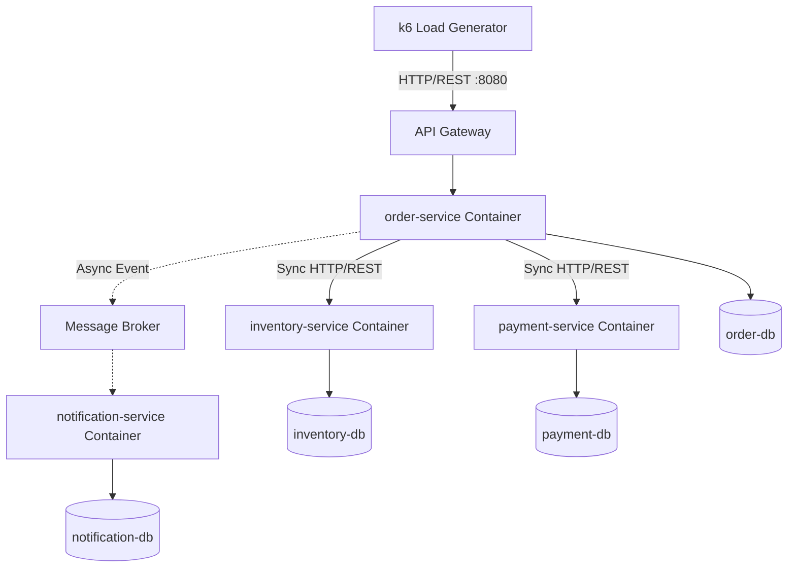

# CHƯƠNG 4. THIẾT KẾ VÀ TRIỂN KHAI THỰC NGHIỆM

Chương này thiết lập bộ khung thiết kế thực nghiệm có kiểm soát (*Controlled Experiment*) nhằm kiểm định năm giả thuyết $H_1 \dots H_5$ đã đề xuất ở Chương 3. Toàn bộ thiết kế được xây dựng trước khi lập trình và chạy kiểm thử tải để bảo đảm tính khách quan, khả năng tái lập (*reproducibility*) và sự công bằng giữa hai kiến trúc.

---

## 4.1. Mục tiêu và Phương pháp Thực nghiệm

Mục tiêu của thực nghiệm là đo lường trực tiếp sự khác biệt về **hiệu năng xử lý**, **mức tiêu thụ tài nguyên phần cứng** và **độ phức tạp vận hành** giữa hai phiên bản hệ thống có chức năng nghiệp vụ tương đương: **Modular Monolith** và **Microservices**.

Nhằm khắc phục hai hạn chế phổ biến của các nghiên cứu đi trước đã chỉ ra ở Mục 3.7 (so sánh bất đối xứng về công nghệ hoặc bỏ qua giới hạn tài nguyên), thực nghiệm áp dụng ba nguyên tắc kiểm soát chặt chẽ:
1. **Tương đồng công nghệ (*Tech-stack Parity*):** Hai phiên bản sử dụng cùng ngôn ngữ lập trình, cùng *framework* nền tảng, cùng hệ quản trị cơ sở dữ liệu và cùng logic xử lý nghiệp vụ. Mọi thành phần hạ tầng phát sinh thêm ở Microservices (như *API Gateway*, *Message Broker* hoặc container cơ sở dữ liệu tách biệt) được ghi nhận riêng như một phần chi phí của kiến trúc phân tán.
2. **Tương đồng triển khai (*Deployment Parity*):** Cả hai phiên bản đều được đóng gói bằng Docker và điều phối trên cùng môi trường Docker Compose trên một máy chủ vật lý thống nhất.
3. **Phân tách hai chế độ đánh giá (theo định hướng tại Chương 3):**
   - **Chế độ `E1 – Resource Parity` (So sánh hiệu năng và chi phí nền):** Cấp phát tổng giới hạn CPU và RAM ngang bằng nhau cho tầng ứng dụng của hai kiến trúc nhằm đo chi phí thuần túy của cách tổ chức mô-đun và giao tiếp qua mạng.
   - **Chế độ `E2 – Scaling Evaluation` (Đánh giá khả năng mở rộng chọn lọc):** Cho phép tăng số lượng *instance* (nhân bản toàn bộ Modular Monolith so với nhân bản riêng dịch vụ nghẽn cổ chai ở Microservices) khi tải tập trung vào một thành phần nghiệp vụ cụ thể.

---

## 4.2. Thiết kế Nghiệp vụ Mẫu

Thực nghiệm lựa chọn bài toán **Xử lý đơn hàng (*Order Processing*)** — luồng nghiệp vụ kinh điển trong hệ thống thương mại điện tử đòi hỏi tương tác đa thành phần và bảo đảm tính toàn vẹn dữ liệu. Hệ thống gồm bốn thành phần chức năng:

- **`Order` (Quản lý đơn hàng):** Tiếp nhận yêu cầu đặt hàng, kiểm tra hợp lệ đầu vào, khởi tạo đơn hàng ở trạng thái `PENDING`, điều phối quy trình xử lý và cập nhật trạng thái cuối (`CONFIRMED` hoặc `CANCELLED`).
- **`Inventory` (Quản lý tồn kho):** Kiểm tra số lượng tồn kho khả dụng, thực hiện giữ chỗ (*reserve stock*) khi tạo đơn và giải phóng tồn kho (*release stock*) nếu bước thanh toán thất bại.
- **`Payment` (Xử lý thanh toán):** Kiểm tra số dư hoặc thực hiện trừ tiền/xác nhận thanh toán cho đơn hàng, có khả năng mô phỏng trạng thái thành công hoặc thất bại có kiểm soát (ví dụ: không đủ số dư hoặc quá thời gian chờ).
- **`Notification` (Thông báo):** Ghi nhận và phát thông báo trạng thái đơn hàng sau khi giao dịch kết thúc (chạy bất đồng bộ để không chặn luồng phản hồi chính).

### Hợp đồng chức năng chung (*Shared Functional Contract*)
Cả hai phiên bản đều cung cấp cùng một bộ giao diện REST API cho công cụ kiểm thử tải `k6`:
- `POST /api/orders`: Đầu vào JSON gồm `customerId`, `items` (`productId`, `quantity`) và `paymentMethod`; đầu ra trả về `orderId`, `status` (`CONFIRMED` hoặc `CANCELLED`), và `totalAmount`.
- `GET /api/orders/{id}`: Truy vấn trạng thái và chi tiết đơn hàng (dùng cho kịch bản đọc dữ liệu tổng hợp hoặc kiểm tra sau giao dịch).

### Hai luồng nghiệp vụ cốt lõi
1. **Luồng thành công (*Happy Path*):** `Order` tạo đơn `PENDING` $\rightarrow$ `Inventory` giữ chỗ tồn kho thành công $\rightarrow$ `Payment` thanh toán thành công $\rightarrow$ `Order` chuyển trạng thái `CONFIRMED` $\rightarrow$ phát sự kiện để `Notification` ghi nhận thông báo.
2. **Luồng thất bại cần hoàn tác (*Failure & Compensation Path*):** `Order` tạo đơn `PENDING` $\rightarrow$ `Inventory` giữ chỗ tồn kho thành công $\rightarrow$ `Payment` trả về lỗi thanh toán (hoặc *timeout* trong kịch bản *Fault Injection*) $\rightarrow$ hệ thống phải hoàn tác trạng thái tồn kho đã giữ (`rollback` cục bộ ở Modular Monolith; giao dịch bù trừ `ReleaseStock` ở Microservices) và chuyển đơn hàng về trạng thái `CANCELLED`.

---

## 4.3. Thiết kế Kiến trúc Thực nghiệm

### 4.3.1. Phiên bản Modular Monolith
Toàn bộ bốn thành phần (`Order`, `Inventory`, `Payment`, `Notification`) được tổ chức thành bốn mô-đun độc lập bên trong một ứng dụng duy nhất. Mỗi mô-đun tuân thủ ranh giới đóng gói nghiêm ngặt: chỉ giao tiếp qua *Public Interface* và DTO, không truy cập trực tiếp vào *Repository* hay *Entity* của mô-đun khác, và sử dụng cơ chế kiểm tra ranh giới tự động (*Spring Modulith* hoặc kiểm thử kiến trúc *ArchUnit*). Giao tiếp đồng bộ (`Order` $\rightarrow$ `Inventory`, `Payment`) thực hiện qua lời gọi hàm nội bộ trong cùng tiến trình (*in-process call*), trong khi `Notification` nhận sự kiện qua *in-memory event bus*. Toàn bộ dữ liệu nằm trên một instance **PostgreSQL** duy nhất nhưng tách biệt thành bốn *schema* (`order_schema`, `inventory_schema`, `payment_schema`, `notification_schema`) và cấm tuyệt đối câu lệnh `JOIN` chéo giữa các *schema*.

### 4.3.2. Phiên bản Microservices
Hệ thống được tách thành bốn dịch vụ độc lập chạy trên bốn container riêng biệt (`order-service`, `inventory-service`, `payment-service`, `notification-service`), đứng sau một **API Gateway** làm điểm tiếp nhận thống nhất cho `k6`. Các lời gọi đồng bộ giữa `order-service`, `inventory-service` và `payment-service` sử dụng HTTP/REST qua mạng Docker nội bộ, kèm cấu hình *timeout* và cơ chế xử lý lỗi/bù trừ theo mẫu **Saga (Orchestration)** tại `order-service`. Thông báo bất đồng bộ tới `notification-service` được thực hiện qua **Message Broker** (hoặc cơ chế hàng đợi nhẹ nhất quán với thiết kế) kèm bảng *Transactional Outbox* / kiểm tra *Idempotency* để bảo đảm không mất sự kiện khi có lỗi. Mỗi dịch vụ sở hữu một instance cơ sở dữ liệu **PostgreSQL** riêng (*Database per Service*).

---

## 4.4. Công nghệ và Môi trường Triển khai

Để tối ưu sự tương đồng công nghệ và tận dụng hệ sinh thái hỗ trợ kiểm soát ranh giới mô-đun đã được kiểm chứng trong tài liệu của Su và Li (2024), bộ công nghệ thực nghiệm được lựa chọn như sau:

| Thành phần | Modular Monolith | Microservices | Ghi chú kiểm soát (*Parity*) |
| :--- | :--- | :--- | :--- |
| **Ngôn ngữ & Runtime** | Java 21 (LTS) | Java 21 (LTS) | Dùng chung cùng một *base Docker image* JDK/JRE |
| **Framework chính** | Spring Boot 3.x + **Spring Modulith** | Spring Boot 3.x + **Spring Cloud Gateway** | Cùng cấu hình Web server (Tomcat/Netty) và JSON serializer (Jackson) |
| **Cơ sở dữ liệu** | PostgreSQL 16 (1 instance, 4 schemas) | PostgreSQL 16 (4 instances tách biệt) | Cùng phiên bản engine, cùng cấu hình *connection pool* (HikariCP) |
| **Giao tiếp bất đồng bộ** | Spring Application Events (*in-memory*) | RabbitMQ (tách riêng chi phí vận hành) | Ghi nhận riêng tài nguyên của RabbitMQ & Gateway |
| **Container & Điều phối** | Docker & Docker Compose | Docker & Docker Compose | Triển khai trên cùng máy chủ vật lý |
| **Công cụ kiểm thử tải** | **k6** | **k6** | Dùng chung một bộ kịch bản `k6` trỏ vào cổng `:8080` |
| **Giám sát & Thu thập** | **Prometheus** + **Grafana** + cAdvisor / `docker stats` | **Prometheus** + **Grafana** + cAdvisor / `docker stats` | Thu thập định kỳ CPU%, RAM (MiB), JVM metrics |

- **Cấu hình giới hạn tài nguyên cho chế độ `E1 – Resource Parity`:** Tổng tài nguyên cấp phát cho tầng ứng dụng của hai kiến trúc được cố định bằng nhau thông qua tham số `cpus` và `mem_limit` trong `docker-compose.yml` (ví dụ: Modular Monolith được cấp `2.0 CPU / 1024 MB` hoặc `4.0 CPU / 2048 MB`; Microservices chia tổng ngân sách tương đương đó cho các container dịch vụ và ghi nhận riêng phần tài nguyên tối thiểu của Gateway/Broker). Cấu hình phần cứng máy chủ thực tế (CPU, RAM vật lý, SSD, phiên bản hệ điều hành và Docker Engine) sẽ được ghi nhận đầy đủ trong báo cáo kết quả ở Chương 5.

---

## 4.5. Thiết kế Kịch bản Kiểm thử

Tất cả kịch bản kiểm thử tải được thực thi tự động bằng công cụ `k6` sau một giai đoạn làm nóng hệ thống (*warm-up*: 30 giây ở tải nhẹ để ổn định *JIT compilation* của JVM và *database connection pool*). Dữ liệu trong giai đoạn *warm-up* bị loại bỏ khỏi tập kết quả phân tích. Năm nhóm kịch bản được thiết kế như sau:

| Mã kịch bản | Tên kịch bản | Mô hình tải (`k6`) | Tham số tải dự kiến & Mục tiêu đo | Giả thuyết kiểm định |
| :--- | :--- | :--- | :--- | :---: |
| **K1** | **Load Testing (Thấp / TB / Cao)** | *Closed Model* (`VUs` cố định) | Ba mức tải tăng dần (ví dụ: 20, 100, 250 VUs; mỗi mức giữ ổn định 3 phút, 80% `POST /api/orders` + 20% `GET /api/orders/{id}`) để đo đường cong `p50`/`p95`/`p99`, RPS và RAM/CPU | $H_1, H_2, H_5$ |
| **K2** | **Stress Testing** | *Ramping VUs* | Tăng dần VUs theo bậc thang cho đến khi tỷ lệ lỗi vượt ngưỡng 5% hoặc `p95` vượt SLA (ví dụ 2.000 ms) nhằm xác định điểm bão hòa thông lượng tối đa | $H_1, H_2$ |
| **K3** | **Spike Testing** | *Sudden Burst* | Tăng đột ngột tải từ mức nền (20 VUs) lên đỉnh (ví dụ 300 VUs trong 30 giây) rồi hạ về mức nền để quan sát khả năng hấp thụ xung tải và tốc độ phục hồi hàng đợi | $H_1, H_2$ |
| **K4** | **Fault Injection** | Tải ổn định (50 VUs) + Tiêm lỗi | Mô phỏng hai loại sự cố có kiểm soát: (a) lỗi nghiệp vụ `PaymentFailed` (tỷ lệ 15%) để đo chi phí Saga/Rollback; (b) tiêm độ trễ 2.000 ms hoặc dừng container `payment-service` để đo bán kính lan truyền lỗi (*blast radius*) và thời gian khoanh vùng lỗi (*MTTD*) | $H_3, H_5$ |
| **K5** | **Selective Scaling (`E2`)** | *Open Model* (`constant-arrival-rate`) | Tạo nút cổ chai CPU/xử lý nhân tạo tại thành phần `Payment` (hoặc `Inventory`); so sánh nhân bản toàn bộ Modular Monolith (1 $\rightarrow$ 3 instances sau Nginx/LB) với nhân bản chọn lọc riêng `payment-service` (1 $\rightarrow$ 3 instances) trong Microservices | $H_4$ |

> [!NOTE]
> Tham số VUs cụ thể ở `K1`–`K3` sẽ được hiệu chỉnh một lần trong bước *pilot run* sao cho mức tải cao chạm vùng 70%–85% năng lực của cấu hình máy đo thực tế, sau đó giữ cố định hoàn toàn cho mọi lượt chạy chính thức.

---

## 4.6. Các Chỉ số Đánh giá Hiệu năng và Tài nguyên

Dữ liệu hiệu năng từ `k6` (xuất ra định dạng JSON/CSV và đẩy về InfluxDB/Prometheus) kết hợp với dữ liệu tài nguyên từ `cAdvisor` / `docker stats` (lấy mẫu mỗi 1–2 giây) được tổng hợp qua sáu chỉ số chính:

- **Độ trễ theo phân vị (*Latency Percentiles: `p50`, `p95`, `p99`* - đơn vị `ms`):** Đo thời gian phản hồi đầu cuối (*end-to-end*) tính từ khi `k6` gửi yêu cầu đến khi nhận đủ phản hồi HTTP. Tập trung đặc biệt vào `p95` và `p99` để phát hiện hiện tượng khuếch đại độ trễ đuôi.
- **Thông lượng (*Throughput* - đơn vị `requests/second`):** Số yêu cầu hoàn tất hợp lệ trên mỗi giây trong khoảng thời gian tải ổn định (*steady-state window*).
- **Tỷ lệ lỗi (*Error Rate* - đơn vị `%`):** Tỷ lệ phần trăm các yêu cầu trả về mã HTTP `5xx` hoặc quá thời gian chờ (*timeout*) ngoài kịch bản lỗi nghiệp vụ chủ đích.
- **Mức sử dụng CPU (*CPU Utilization* - đơn vị `%` hoặc `cores`):** Tổng mức CPU tiêu thụ trung bình và đỉnh của toàn bộ các container thuộc từng kiến trúc (tách riêng container ứng dụng, Gateway/Broker và CSDL).
- **Mức tiêu thụ Bộ nhớ (*Memory Consumption* - đơn vị `MiB`):** Đo cả **bộ nhớ nền khi nhàn rỗi (*idle footprint*)** và **bộ nhớ đỉnh khi chịu tải (*peak RSS/working set*)** của từng container và tổng cộng toàn hệ thống.
- **Tài nguyên tiêu thụ trên mỗi yêu cầu (*Resource Consumption per Request*):** Chỉ số dẫn xuất tính bằng công thức $\text{CPU-ms/req} = \frac{\text{CPU cores} \times 1000}{\text{Throughput (RPS)}}$ và $\text{RAM-MB/RPS} = \frac{\text{Peak RAM (MiB)}}{\text{Throughput (RPS)}}$, giúp chuẩn hóa chi phí phần cứng trên một đơn vị công việc.

---

## 4.7. Phương pháp Đo Độ phức tạp Vận hành

Tuân thủ nguyên tắc tại Mục 5.2 của [huongdan.md](file:///d:/HocTap_TLU/ChuyenNganh_CNTT_AI/chuyendeKTPM/guide/huongdan.md) và khung đề xuất từ Tổng hợp Nhóm 3, nghiên cứu **không gộp** các thước đo vận hành thành một điểm số tổng hợp tùy ý, mà giữ **sáu chỉ số độc lập**, định lượng trực tiếp trên mã nguồn và quá trình vận hành hai hệ thống thực nghiệm:

1. **Độ phức tạp triển khai (*Deployment Footprint*):** Đếm chính xác số lượng *container/service* phải chạy đồng thời, số lượng *repository/build module*, và tổng số tệp cấu hình triển khai (`Dockerfile`, `docker-compose.yml`, cấu hình Gateway/Prometheus/Broker).
2. **Khối lượng mã nguồn hạ tầng (*Infrastructure & Config Surface*):** Đếm tổng số dòng cấu hình (*YAML/Properties/Config LOC*) và số lượng biến môi trường (*environment variables*) cần khai báo để hai hệ thống khởi chạy đúng.
3. **Thời gian xây dựng và triển khai (*Build & Deployment Time*):** Đo thời gian biên dịch từ mã nguồn sạch (*clean build*), đóng gói Docker *image* và thời gian để toàn bộ cụm sẵn sàng nhận lưu lượng (*healthcheck passed*).
4. **Thời gian dựng môi trường (*Environment Setup Time*):** Đo thời gian và số bước thủ công/tự động cần thiết để khởi tạo mới hoàn toàn cơ sở dữ liệu, *schema*, *seed data* và mạng nội bộ từ trạng thái trống.
5. **Thời gian phát hiện và chẩn đoán lỗi (*Fault Diagnosis Time / MTTD*):** Trong kịch bản tiêm lỗi `K4`, ghi nhận số lượng nguồn nhật ký (*log streams*) cần kiểm tra, độ sâu chuỗi gọi (*call-chain depth*) và thời gian thực tế để khoanh vùng đúng dịch vụ/mô-đun phát sinh lỗi dựa trên bộ công cụ giám sát đi kèm.
6. **Lan truyền thay đổi (*Change Propagation*):** Phân tích tĩnh trên cấu trúc mã nguồn khi bổ sung một trường dữ liệu mới vào đơn hàng (ví dụ `discountCode`): đếm số lượng mô-đun/dịch vụ, số tệp giao diện/DTO và số *pipeline* triển khai phải chỉnh sửa và phát hành lại.

---

## 4.8. Phương pháp Xử lý Dữ liệu và Kiểm định Giả thuyết

Để loại bỏ nhiễu ngẫu nhiên của hệ điều hành và *Garbage Collector* trên JVM, mỗi kịch bản kiểm thử (`K1`–`K5`) được chạy lặp lại tối thiểu **5 đến 10 lần độc lập** (dọn sạch trạng thái hoặc khởi động lại container giữa các lượt nếu cần để tránh trôi dữ liệu CSDL). Quy trình xử lý thống kê gồm ba bước:

1. **Thống kê mô tả:** Báo cáo giá trị trung vị (*median*), trung bình (*mean*), độ lệch chuẩn (*standard deviation*) và khoảng tứ phân vị (*IQR*) cho các chỉ số `p50`, `p95`, `p99`, `RPS`, `CPU` và `RAM`.
2. **Kiểm tra phân phối và kiểm định giả thuyết:** Kiểm tra tính chuẩn của dữ liệu lặp bằng kiểm định *Shapiro-Wilk*. Do dữ liệu độ trễ mạng và phân vị thường có phân phối lệch phải, nghiên cứu sử dụng kiểm định phi tham số **Mann-Whitney U** hai phía ở mức ý nghĩa $\alpha = 0{,}05$ để đánh giá sự khác biệt có ý nghĩa thống kê giữa Modular Monolith và Microservices.
3. **Đo lường độ lớn hiệu ứng (*Effect Size*):** Tính toán chỉ số **Cliff's Delta ($\delta$)** (tương tự phương pháp của Tofan, 2026) để xác định mức độ chênh lệch thực chất (*negligible, small, medium, large*) thay vì chỉ dựa vào trị số $p$-value.

---

## 4.9. Các Mối đe dọa đến Tính hợp lệ của Thực nghiệm (Threats to Validity)

Nhằm bảo đảm tính trung thực khoa học, bốn nhóm mối đe dọa đến tính hợp lệ của thiết kế thực nghiệm được nhận diện trước như sau:

- **Tính hợp lệ nội tại (*Internal Validity*):** Các tiến trình nền của hệ điều hành chủ hoặc bộ thu gom rác JVM (*GC pauses*) có thể gây dao động độ trễ cục bộ. Biện pháp giảm thiểu là tắt các ứng dụng không liên quan khi chạy benchmark, thực hiện giai đoạn *warm-up*, lặp lại nhiều lượt chạy độc lập và dùng kiểm định thống kê phi tham số.
- **Tính hợp lệ ngoại tại (*External Validity*):** Thực nghiệm triển khai trên một máy chủ vật lý duy nhất qua Docker Compose với nghiệp vụ mẫu gồm bốn thành phần. Do đó, kết quả ở chế độ `E1` phản ánh đúng hành vi của hệ thống trong môi trường đơn nút hoặc giới hạn tài nguyên ngang bằng, **không thể suy diễn trực tiếp** để phủ nhận lợi thế mở rộng ngang của Microservices trên các cụm *cloud* đa máy chủ quy mô lớn.
- **Tính hợp lệ cấu trúc (*Construct Validity*):** Độ phức tạp vận hành ngoài thực tế còn chịu ảnh hưởng bởi quy mô đội ngũ và quy trình tổ chức (như Waseem và các cộng sự, 2023/2025 đã chỉ ra). Vì thực nghiệm chỉ thực hiện trong phạm vi nhóm nghiên cứu, mục `4.7` giới hạn ở các chỉ số kỹ thuật đo đếm khách quan (số thành phần, cấu hình, thời gian build/deploy/MTTD, *change propagation*) thay vì tự chấm điểm cảm tính.
- **Tính hợp lệ kết luận (*Conclusion Validity*):** Việc lựa chọn ngăn xếp `Java 21 / Spring Boot 3 / PostgreSQL 16` mang đặc trưng tiêu thụ bộ nhớ của JVM. Mức chênh lệch tuyệt đối về RAM nền có thể khác với các nền tảng biên dịch *native* như Go hay Rust, song cơ chế nhân bản *runtime* và chi phí giao tiếp qua mạng vẫn mang tính quy luật chung của kiến trúc.
